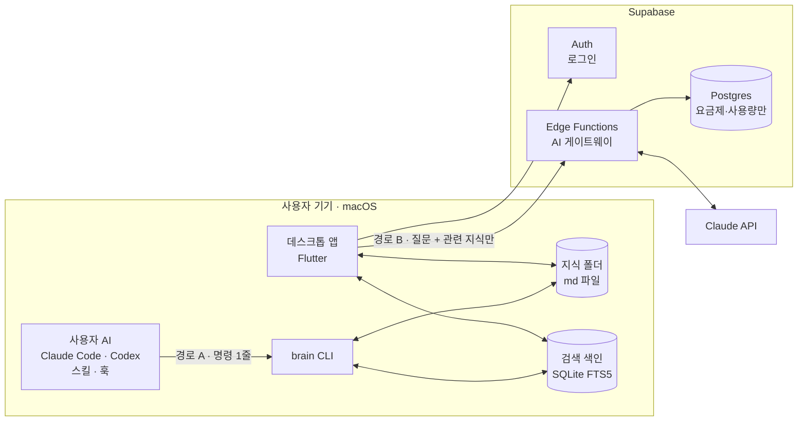
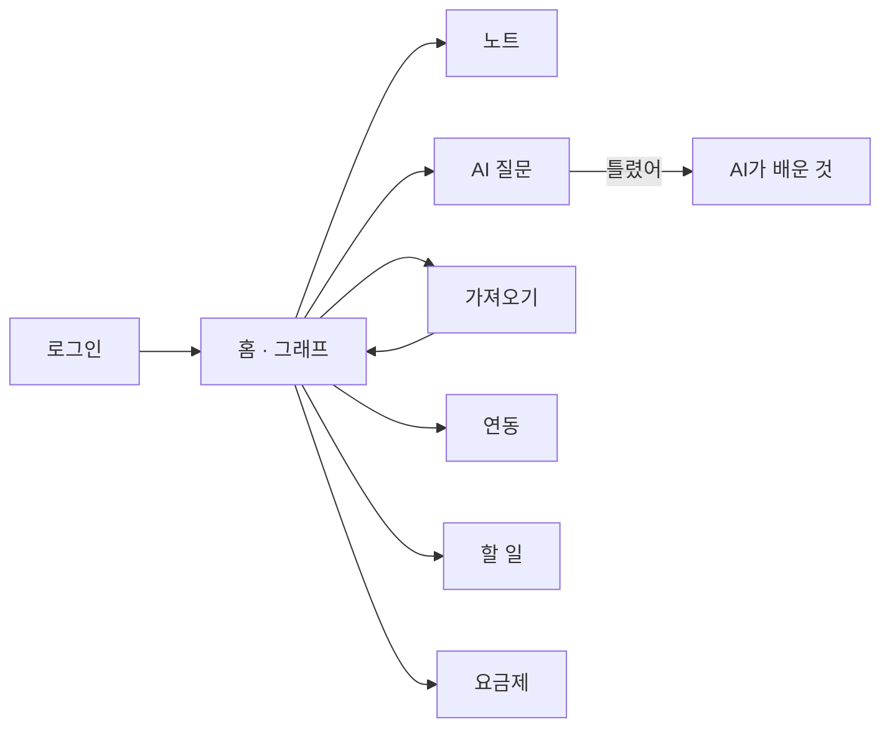
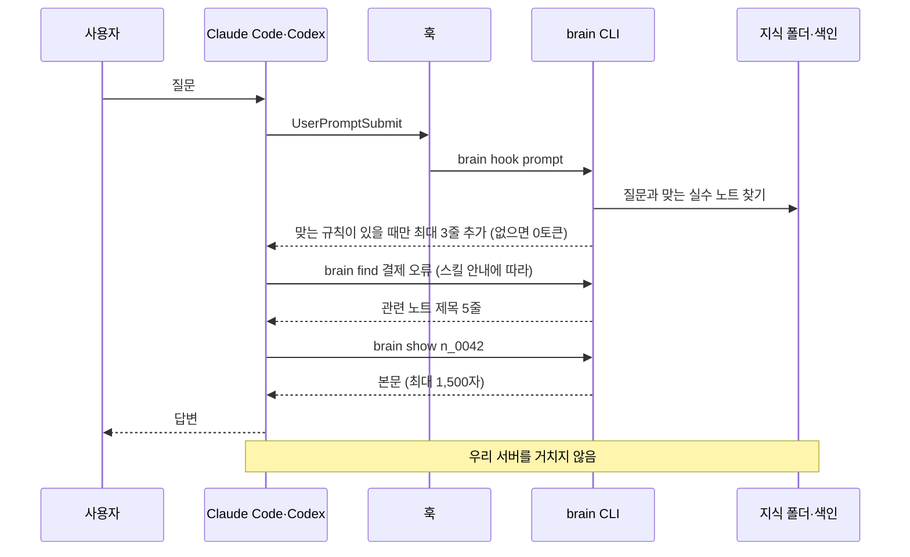
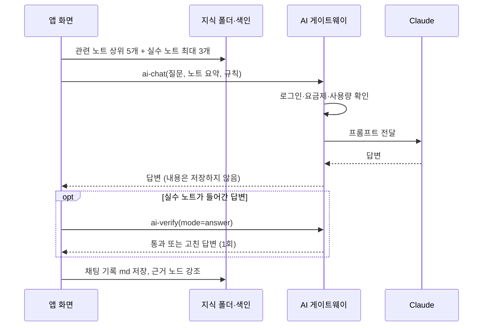
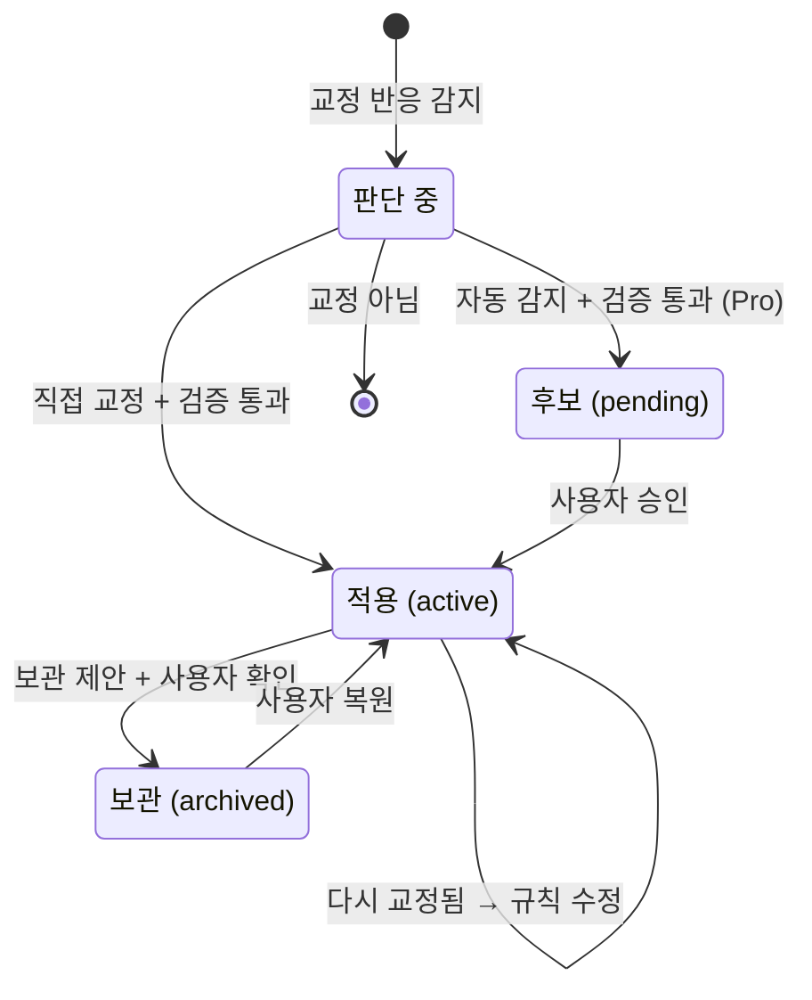

# 세컨드 브레인 플랫폼 — 내부 설계서 v1.2

> 개발 기준 문서. 교수님 제출용 기획안(`기말프로젝트_기획안_김민상.pdf`)이 "무엇을·왜"라면, 이 문서는 "어떻게"를 정한다. 기획안과 내용이 다르면 이 문서를 고치고 기획안에 반영한다.

- **작성**: 2026-11-05 · 김민상
- **마감**: 2026-12-08 (제출)
- **상태**: v1.2 — 웹을 홍보 페이지로 변경. [7. 미결정 사항](#7-미결정-사항) 확정 후 v1.3

| 버전 | 날짜 | 내용 |
|---|---|---|
| v1.0 | 2026-11-05 | 초안 (웹 + IndexedDB + 임베딩 검색 + 서버 중계) |
| v1.1 | 2026-11-05 | 교수님 피드백 9건 반영 ([부록 A](#부록-a-교수님-피드백-반영표-2026-11-05)): 데스크톱 우선, md 파일 저장, 원문 검색 색인, brain CLI·연동 스킬, 검증 에이전트 |
| v1.2 | 2026-11-05 | 웹을 Flutter 체험판에서 **홍보 페이지**(Astro 정적 사이트)로 변경. 웹에서는 앱 기능을 돌리지 않는다 ([2.2](#22-기술-선택), [3.1](#31-홍보-페이지-웹)) |

## TL;DR

- **구조**: Flutter macOS 데스크톱 앱이 본 제품이고 웹은 홍보 페이지다. 지식은 기기에 **md 파일**로 두고 **SQLite FTS5 색인**으로 찾는다. 서버(Supabase)는 로그인·요금제·AI 게이트웨이만 맡는다.
- **두 경로**: (A) 연동한 AI(Claude Code·Codex)가 스킬을 보고 **brain CLI** 명령 한 줄로 기기의 지식을 직접 찾는다 — 서버·임베딩 없음. (B) 앱 안 AI 질문만 AI 게이트웨이를 거친다.
- **교정**: 점수 규칙 대신 **검증 에이전트**가 판단하고, 자기가 놓친 실수로 검사 기준을 스스로 고친다(RSI).

---

## 1. 원칙

| 원칙 | 지키는 방법 |
|---|---|
| **지식은 기기에** | 노트·그래프·실수 노트·할 일·채팅 기록은 기기의 md 파일과 색인에만 둔다. 서버 테이블·로그에 저장 금지 |
| **연동 경로는 서버를 거치지 않음** | 경로 A는 기기 안에서 끝난다. 찾은 지식은 사용자 본인의 AI 서비스(대화의 일부)로만 전달된다 |
| **묻지 않고 자동 저장, 숨기지는 않음** | 저장 확인 창 없음. 지식 폴더 위치는 설정 화면·개인정보처리방침에 명시하고 Finder에서 열 수 있게 한다 |
| **비밀값은 서버에만** | AI API 키는 Edge Functions 환경변수에만 둔다. Flutter·CLI 코드와 저장소에 넣지 않는다 |
| **요금제 판단은 서버가** | 앱이 보내는 요금제 값을 믿지 않는다. 사용량·등급 확인은 Edge Function에서 한다 |
| **토큰은 아껴서** | CLI 결과는 기본 5줄, 본문은 요청할 때만 연다. 훅은 맞는 규칙이 있을 때만 내용을 넣는다 (없으면 0토큰) |
| **AI 변경은 되돌릴 수 있게** | 규칙·자동 변경은 모두 변경 기록을 남기고 되돌릴 수 있다. 자동 감지한 규칙은 사용자 승인 후 적용한다 |

## 2. 시스템 구조



### 2.1 두 경로

| 구분 | 경로 A: 연동한 AI | 경로 B: 앱 안 AI 질문 |
|---|---|---|
| 질문하는 곳 | Claude Code·Codex (평소처럼) | 데스크톱 앱 `/chat` |
| 지식 찾기 | AI가 `brain find` 실행 → 제목 5줄 | 앱이 색인에서 노트 5개·실수 노트 최대 3개 |
| 지식 읽기 | 필요한 노트만 `brain show` | 찾은 것만 게이트웨이로 전송 |
| 답하는 AI | 사용자 본인의 AI | 게이트웨이 → Claude API |
| 우리 서버 | **거치지 않음** | 등급·사용량 확인만, 내용 저장 안 함 |
| 우리 비용 | 없음 (검색 명령 10토큰 안팎) | 사용량 1회 차감 |

### 2.2 기술 선택

| 영역 | 선택 | 대안과 미채택 이유 |
|---|---|---|
| 앱 형태 | Flutter **macOS 데스크톱** | Flutter Web 본 제품 — IndexedDB가 느리고, 사용자 AI가 브라우저 저장소를 읽을 수 없음 |
| 웹 | **홍보 페이지**: Astro + Tailwind 정적 사이트 (astrowind 템플릿으로 시작) | Flutter Web 체험판 — 화면을 캔버스로 그려 검색 노출이 약하고 첫 화면이 느림. 앱 화면을 웹용으로 한 벌 더 관리해야 함 |
| 지식 저장 | **md 파일** (메타데이터는 frontmatter) | DB에만 저장(sembast 등) — 사용자 AI·Obsidian이 직접 읽을 수 없음 |
| 검색 색인 | **SQLite FTS5 + BM25**, 한글은 2글자 분할 (`sqlite3`) | 임베딩 검색 — 노트를 외부 임베딩 서비스로 보내야 하고 개인 규모에서는 원문 검색으로 충분 (2단계 선택). 형태소 분석기(Kiwi 등) — 정확하지만 Dart에서 쓰려면 네이티브 연결이 필요 |
| 연동 | **brain CLI** (Dart, `dart compile exe`) + 스킬·훅 | MCP 서버 — 연결해 두면 도구 설명이 대화에 계속 실려 토큰을 씀 (2단계, CLI를 못 쓰는 도구용) |
| 상태 관리 | `flutter_riverpod` 3.x | setState·Provider — 화면이 10개라 의존성 관리가 금방 꼬임 |
| 라우팅 | `go_router` 18.x | Navigator 직접 사용 — 화면이 많아지면 관리가 번거로움 |
| 뇌 그래프 | `CustomPainter` + 직접 구현한 force 배치 | `graphview` — 마지막 배포가 2025-10이고 노드가 많으면 위젯 방식이 느림 |
| 서버 | `supabase_flutter` 2.x, Edge Functions(Deno) | 직접 서버 구축 — 로그인·DB·함수를 따로 만들 시간이 없음 |
| LLM | Claude API (기본 후보 `claude-haiku-5-5`) | 모델은 비용 측정 후 확정 ([7번](#7-미결정-사항)) |

> 패키지 버전은 pub.dev 기준. 2026-11-05 확인: sqlite3 3.8.0, path_provider 2.1.6, yaml 3.1.4, args 2.7.0, watcher 1.2.1. 이전 확인: flutter_riverpod 3.4.3, go_router 18.1.3, supabase_flutter 2.18.3.

## 3. 화면과 흐름

| 경로 | 화면 | 핵심 동작 |
|---|---|---|
| `/login`, `/signup` | 로그인·회원가입 | Supabase 이메일 로그인 |
| `/` | 홈 (뇌 그래프) | 그래프 탐색, 노드 누르면 노트 열기, 검색 |
| `/notes`, `/notes/:id` | 노트 목록·편집 | 작성·수정·삭제, `[[제목]]`으로 연결 |
| `/chat` | AI 질문 (경로 B) | 위키 기반 답변, [틀렸어] 버튼, 근거 노트 표시 |
| `/lessons` | AI가 배운 것 | 실수 노트·검증 기록·검사 기준 보기, 승인·수정·삭제, 변경 이력 |
| `/todos` | 할 일 | 추가·완료, 노트·대화에서 가져온 할 일 |
| `/import` | 가져오기 | ChatGPT·Claude 내보내기 파일, Claude Code·Codex 세션 기록 |
| `/connect` | 연동 | Claude Code·Codex 온보딩 설치·해제, 연동 상태 |
| `/pricing` | 요금제 | 무료·Pro 비교, 모의 결제 |
| `/settings` | 설정 | 지식 폴더 위치·Finder에서 열기, 백업·복원, 계정 |



### 3.1 홍보 페이지 (웹)

웹은 서비스를 소개하고 macOS 앱을 내려받게 하는 홍보 페이지다. 웹에서는 로그인·노트·AI 질문 같은 앱 기능을 돌리지 않고, 지식 데이터도 다루지 않는다. 가입과 결제는 앱에서 한다.

| 구역 | 내용 |
|---|---|
| 첫 화면 | 한 줄 소개, 샘플 데이터로 움직이는 뇌 그래프, [macOS 앱 받기] |
| 문제와 해결 | 기획안 1절의 문제 3개와 해결 방향 |
| 기능 | MVP 기능 (노트, 뇌 그래프, AI 도구 연동, AI 질문, 실수 노트, 할 일) |
| 연동 흐름 | Claude Code·Codex → 스킬 → brain CLI → 지식 폴더. 우리 서버를 거치지 않는다는 점을 그림으로 보여 준다 |
| 데이터 보호 | 지식은 내 기기에만 저장된다는 설명, 개인정보처리방침 |
| 요금제 | 무료·Pro 비교 (수치는 [미결정 5](#7-미결정-사항) 확정 후) |
| 자주 묻는 질문·다운로드 | FAQ, `.dmg` 다운로드 |

- **기술**: Astro + Tailwind, astrowind 템플릿으로 시작한다. 빌드 결과는 정적 파일이라 서버가 필요 없다. 배포처(정적 호스팅)는 4주차에 정한다.
- **디자인**: 앱과 같은 색·모서리·아이콘(Lucide)을 쓴다.
- **뇌 그래프**: 앱 그래프와 같은 force 배치 방식의 자바스크립트 라이브러리를 쓴다(후보 `force-graph`, [참고레포_조사](참고레포_조사.md) 1절). 샘플 데이터만 넣는다.

## 4. 데이터 설계

### 4.1 지식 폴더 (md 파일)

기본 위치는 `~/Library/Application Support/<번들 ID>/vault`이다. 앱과 CLI가 같은 경로를 쓰고, `BRAIN_VAULT` 환경변수로 바꿀 수 있다.

```text
vault/
  index.md            # 자동 생성 목차: 주제 폴더 목록과 한 줄 설명
  _profile.md         # 온보딩 요약: 주요 주제, 자주 받은 교정 (자동 생성)
  wiki/               # 정리된 노트 — 평소 검색 대상
    <주제>/index.md   # 주제별 목차
    <주제>/<제목>.md
  raw/                # 원본 — 기본 검색에서 제외
    imports/          # 가져온 대화
    sessions/         # Claude Code·Codex 세션 기록
  lessons/            # 실수 노트 1개 = 파일 1개
    L-0001.md
    _verifier.md      # 검증 에이전트 검사 기준 (RSI로 늘어남)
  todos.md            # 할 일 체크리스트
  chats/              # 앱 안 AI 질문 기록
```

```md
---
id: n_0042
title: 결제 웹훅 재시도 규칙
tags: [결제, 서버]
source: chat          # manual | import | chat | session
created: 2026-11-20T10:00:00+09:00
updated: 2026-11-21T09:12:00+09:00
---
본문… [[토스 결제 테스트 키]]
```

```md
---
id: L-0007
status: active        # pending | active | archived
trigger: 결제 코드를 수정할 때
action: 테스트 키로 먼저 확인한 뒤 실제 키를 쓴다
reason: 실제 키로 바로 테스트해 결제가 나간 적이 있음
source: explicit      # explicit(직접 교정) | observed(자동 감지)
evidence: { kept: 3, recorrected: 0, lastSeen: 2026-11-28 }
---
교정 원문과 검증 에이전트 판단 기록
```

- 파일 이름 = 제목이다. 그래서 `[[제목]]` 링크가 파일 이름과 맞는다(Obsidian 호환). 제목이 바뀌면 링크도 함께 고치고 변경 기록을 남긴다.
- **macOS 앱 샌드박스는 끄고 직접 배포**한다. CLI와 사용자 AI가 같은 폴더를 읽어야 하기 때문이다. App Store 배포는 2단계에서 검토한다.

### 4.2 검색 색인 (SQLite `index.db`)

색인은 원본이 아니다. md 파일에서 언제든 다시 만들 수 있다(`brain index --rebuild`).

```sql
create table docs (
  id text primary key,          -- n_0042, L-0007
  path text not null unique,
  kind text not null,           -- note | lesson | raw
  title text not null,
  tags text,
  mtime integer not null,
  hash text not null
);
create virtual table docs_fts using fts5(
  doc_id unindexed, title_grams, body_grams, tokenize = 'unicode61'
);
create table links (
  from_id text, to_id text,
  kind text not null,           -- manual([[제목]]) | suggested(추천)
  primary key (from_id, to_id)
);
create table changelog (
  id integer primary key, at text, kind text, target_id text, before text, after text
);
```

- **점수**: `bm25(docs_fts, 0, 3.0, 1.0)`. 제목 일치에 본문보다 3배 가중치를 준다.
- **한국어 2글자 분할**: 한국어는 조사가 붙어 띄어쓰기 단위로는 찾을 수 없다. 그래서 한글 구간은 겹치는 2글자로 잘라 저장한다. 영어·숫자는 단어 그대로 소문자로 저장한다. FTS5 기본 `trigram`은 3글자 미만 검색어가 걸리지 않아서 쓰지 않는다.

  ```text
  원문     "결제 웹훅을 다시 보낸다"
  저장     "결제 웹훅 훅을 다시 보낸 낸다"
  검색어   "웹훅"      →  "웹훅" 일치 (조사 '을'과 상관없음)
  검색어   "결제오류"  →  구절 "결제 제오 오류"로 검색
  ```

- **증분 갱신**: 앱 시작 때 mtime·hash를 비교해 바뀐 파일만 다시 색인한다. 실행 중에는 폴더를 감시해 외부 편집(Obsidian 등)도 반영한다. CLI가 쓰면 CLI가 직접 갱신한다. 앱과 CLI가 동시에 써도 되도록 WAL 모드를 쓴다.
- **md 파일이 많아질 때** (교수님 피드백 4):
  - AI는 파일을 전부 읽지 않는다. `find`가 제목 5줄만 주고, 본문은 `show`로 필요한 것만 연다.
  - `index.md`는 주제 목록만 담는다. 주제별 `index.md`로 한 단계씩 좁힌다.
  - `raw/`는 기본 검색에서 뺀다(`--raw`로 포함).
  - 자동 정리가 중복 노트 합치기를 제안해 파일 수를 줄인다.
  - 3주차에 노트 1만 개 샘플로 검색 시간을 측정한다 (목표 50ms 이하).

### 4.3 서버 (Supabase Postgres) — 지식 없음

```sql
-- 요금제와 사용량만 저장한다. 노트·질문 내용은 어떤 테이블에도 두지 않는다.
create table profiles (
  id uuid primary key references auth.users on delete cascade,
  plan text not null default 'free' check (plan in ('free', 'pro')),
  plan_renews_at timestamptz,
  created_at timestamptz not null default now()
);

create table usage (
  user_id uuid references auth.users on delete cascade,
  month text not null,              -- '2026-11'
  ai_calls int not null default 0,  -- 경로 B만 센다
  primary key (user_id, month)
);
```

- **RLS(행 수준 보안)**: 본인 행만 조회할 수 있고, 수정은 Edge Function(서비스 키)만 할 수 있다.

## 5. 핵심 로직

### 5.1 경로 A — 연동한 AI가 지식 찾기



| 명령 | 하는 일 | 기본 출력 |
|---|---|---|
| `brain find <검색어> [--raw] [--limit 5]` | 원문 검색 | `n_0042  결제 웹훅 재시도 규칙  wiki/결제` 형식, 최대 5줄 |
| `brain show <id> [--from N]` | 노트 열기 | 본문 최대 1,500자, 넘으면 이어 보기 안내 1줄 |
| `brain lesson <상황>` | 실수 노트 찾기 | `L-0007  결제 코드 수정 시 → 테스트 키로 먼저 확인`, 최대 3줄 |
| `brain add [--title T] [--to raw/sessions]` | 저장 (본문은 표준 입력) | 새 id 1줄 |
| `brain lesson add --trigger --action --reason` | 실수 노트 후보 저장 | 새 id 1줄 |
| `brain hook <이벤트>` | 훅 전용 (표준 입력 JSON) | 훅 형식 JSON |
| `brain index [--rebuild]` | 색인 갱신 | 처리 개수 1줄 |

- 기본 출력은 짧은 텍스트다. `--json`은 앱·테스트용이다. JSON은 키 이름이 반복돼 토큰이 늘어나므로 AI에게는 쓰지 않는다.
- 사람이 직접 써도 같은 결과가 나온다. 시연과 디버깅에도 쓴다.

### 5.2 연동 설치 (온보딩)

[연동] 버튼을 누르면, 바뀔 파일 목록을 먼저 보여 주고 확인을 받은 뒤 설치한다. 기존 설정은 백업한 뒤 합친다. 해제하면 우리가 넣은 부분만 지운다.

| 도구 | 설치 위치 | 내용 |
|---|---|---|
| Claude Code | `~/.claude/skills/second-brain/SKILL.md` | brain 명령 사용법 (언제 찾을지, 몇 개 열지) |
| | `~/.claude/agents/brain-verifier.md` | 검증 에이전트 ([5.4](#54-실수-노트와-검증-에이전트)) |
| | `~/.claude/settings.json`의 hooks | SessionStart(온보딩 요약), UserPromptSubmit(규칙·교정 신호), SessionEnd(대화 저장) |
| Codex | `~/.codex/skills/second-brain/SKILL.md` | 같은 스킬 파일 |
| | Codex 사용자 정의 에이전트 | 검증 에이전트 (설치 위치·형식은 1주차에 확인) |
| | `~/.codex/hooks.json` | SessionStart, UserPromptSubmit, SessionEnd |

- **온보딩 요약**: `_profile.md`에서 주요 주제 5개와 자주 받은 교정 3개를 150토큰 이하로 뽑아 SessionStart 때 넣는다. 그러면 AI가 첫 대화부터 사용자를 알고 시작한다. 설정에서 끌 수 있다.
- **SessionEnd는 빠르게**: Codex는 SessionEnd 훅 제한 시간이 기본 1초, 최대 3초다. 그래서 훅에서는 세션 기록 파일 경로만 대기열에 적는다. 요약과 저장은 앱이나 다음 CLI 실행 때 처리한다.
- **근거**: Claude Code·Codex 공식 문서(2026-11-05 확인) 기준으로 두 도구 모두 스킬, SessionStart·UserPromptSubmit·SessionEnd 훅, 훅의 `additionalContext`, 사용자 정의 보조 에이전트를 지원한다. 실제 설치 버전에서 동작은 1주차에 확인한다.

### 5.3 경로 B — 앱 안 AI 질문



- **보내는 양**: 노트는 제목 + 앞부분 500자, 상위 5개. 실수 노트는 조건을 만족하는 것 중 최대 3개.
- **실수 노트 선택 조건**: `status = active`, 질문과의 BM25 점수가 기준값 이상(테스트로 정함).

### 5.4 실수 노트와 검증 에이전트

v1.0의 신뢰도 점수(0.7 시작, +0.05, −0.1)는 없앤다. 사용자는 대충 "좋아"라고 답하는 경우가 많아서, 반응대로 점수를 더하면 점수가 올라가기만 하기 때문이다. 대신 **검증 에이전트**가 판단한다. 사용자 반응은 점수가 아니라 판단 근거로 쓴다.



| 언제 | 입력 | 판단 | 결과 |
|---|---|---|---|
| 교정 반응 감지 ([틀렸어], "아니야", "다시 해") | 질문, 답변, 사용자 반응, 근거 노트 | 진짜 교정인가? 일반 규칙으로 만들 만한가? | 새 규칙 / 기존 규칙과 합치기 / 교정 아님 / 되묻기 |
| 실수 노트가 들어간 답변 | 답변, 적용한 규칙 | 규칙을 지켰나? | 통과 / 한 번 다시 쓰기(B) / 경고(A) |
| 검증이 놓친 실수 (통과시킨 답을 사용자가 나중에 교정) | 놓친 사례 | 어떤 검사 항목이 빠졌나? | `_verifier.md`에 검사 항목 추가 (**RSI**) |

> **RSI(Recursive Self-Improvement)**: AI가 자기 결과를 검사·수정하고, 그 경험으로 다음 결과를 개선하는 과정을 반복하는 방식. 여기서는 모델 가중치가 아니라 AI가 쓰는 규칙과 검사 기준을 개선하는 범위로 한정한다.

- **비용 절약**: 교정 반응의 1차 감지는 기기에서 버튼·단어 규칙으로 한다. 감지됐을 때만 검증 에이전트를 부른다.
- **편향 방지**: 같은 AI가 자기 답을 검사하면 맞다고 하기 쉽다. 그래서 확인할 수 있는 기준만 쓴다. 근거 노트에 있는 내용인지, 사용자 교정 문장과 일치하는지, 규칙의 action을 따랐는지만 본다. "좋아 보인다" 같은 주관 판단은 하지 않는다.
- **기록**: `evidence`(지켜서 문제없던 횟수, 다시 교정된 횟수)를 남기고, 검증 에이전트가 판단 근거로 읽는다.
- **안전장치**: 질문당 적용하는 규칙은 최대 3개, `_verifier.md`는 최대 30항목이다. 넘으면 검증 에이전트가 비슷한 항목을 합친다. 모든 변경은 `changelog`에 남기고 되돌릴 수 있다.
- **실행 위치**: 경로 A는 사용자 AI 안의 보조 에이전트(`brain-verifier`)로 돌아서 우리 비용이 없다. 경로 B는 `ai-verify` 함수로 돈다.
- **출처**: 규칙 문장 형식("언제 → 무엇을 → 왜", 불분명하면 되묻기)만 agent-librarian `rule-creator`(Apache-2.0)를 참고했다. 신뢰도 점수 방식(ECC)은 쓰지 않는다.

### 5.5 뇌 그래프

- **연결**: `[[제목]]` 링크(manual)와 추천 연결(suggested) 두 가지다.
  - 추천 연결은 노트를 저장할 때 제목과 핵심 단어로 색인을 검색해서 만든다. BM25 상위 노트 중 기준값 이상만, 노드당 최대 5개까지 잇는다.
  - 화면에서는 점선으로 그리고, 사용자가 확정하면 manual로 바뀐다.
- **핵심 단어**: 색인 단어 통계(`fts5vocab`)에서 그 문서에 자주 나오고 전체 문서에는 드문 단어 상위 5개를 고른다.
- **배치**: force 배치(밀어내는 힘 + 연결선 당기는 힘)를 직접 구현하고, 300회 반복 후 고정한다. 노드를 끌면 그 노드만 다시 계산한다.
- **그리기**: `CustomPainter` 한 장에 전부 그린다. 확대·이동은 `InteractiveViewer`로 한다.

### 5.6 가져오기

- **대상**: ChatGPT·Claude 데이터 내보내기 파일, Claude Code 세션 기록(`~/.claude/projects/*.jsonl`), Codex 세션 기록(`~/.codex/sessions/**/rollout-*.jsonl`)
- 대화 1개를 `raw/imports/` 또는 `raw/sessions/`의 md 파일 1개로 저장한다.
- **주의**: 실제 파일 형식은 샘플로 확인한 뒤 파서를 만든다. 형식을 추측해서 만들지 않는다.
- **가져오기 직후**:
  1. 핵심 단어가 겹치는 대화끼리 묶는다.
  2. 묶음에 이름을 붙인다. Pro는 `ai-chat`, 무료는 핵심 단어를 그대로 쓴다.
  3. `wiki/` 주제 폴더와 목차를 만든다.
  4. 그래프와 온보딩 요약(`_profile.md`)을 만든다.

### 5.7 데이터 보호

- 지식 폴더 자체가 백업 단위다. 설정에서 폴더째 압축해 내보내고 복원할 수 있다. 마지막 백업 후 7일이 지나면 안내한다.
- 색인이 깨지면 md 파일에서 다시 만든다.
- 연동을 설치하기 전에 기존 AI 도구 설정 파일을 백업한다.

## 6. AI 게이트웨이 (Edge Functions)

v1.0의 "AI 중계"를 **AI 게이트웨이**로 이름을 바꾼다. 하는 일은 세 가지다: API 키 보관, 로그인·요금제·사용량 확인, 앱 안 AI 질문(경로 B) 전달. 경로 A는 이 서버를 쓰지 않는다. 모든 함수는 Supabase 로그인 토큰(JWT)을 확인하고, **요청 본문을 로그에 남기지 않는다.**

| 함수 | 입력 | 출력 | 사용량 차감 |
|---|---|---|---|
| `ai-chat` | `{ task: 'answer' \| 'name_groups', question, notes[{id,title,snippet}], lessons[{trigger,action,reason}] }` | `{ answer, usedNoteIds }` | 1회 |
| `ai-verify` | `{ mode: 'correction' \| 'answer' \| 'missed', question, answer, reaction?, notes, lessons, checklist }` | `{ verdict, lesson?, fixedAnswer?, checkItem?, reason }` | 안 함 (질문 1회에 포함, 별도 일일 한도) |
| `mock-checkout` | `{}` | `{ plan: 'pro', renewsAt }` | - |

- v1.0의 `ai-embed`(임베딩)는 없앴고, `ai-lesson`은 `ai-verify`의 `correction` 모드로 합쳤다.
- **무료 한도(가안)**: 앱 안 AI 질문 월 50회, 노트 200개, 실수 노트 20개. 경로 A는 서버를 거치지 않아 횟수에 포함되지 않는다. 노트·실수 노트 개수는 기기에서 확인한다(저장 비용이 없어 엄격히 막지 않음).

## 7. 미결정 사항

| No. | 내용 | 정할 때 |
|---|---|---|
| 1 | 한국어 분할 방식: 2글자 분할(기본안) 그대로 갈지, 형태소 분석기를 쓸지 — 검색 품질 시험 후 | 2주차 |
| 2 | LLM 모델 확정 (기본 후보 `claude-haiku-5-5`) | 3주차, 비용 측정 후 |
| 3 | 폴더 구조를 기존에 쓰던 Flutter 구조 규칙에 맞출지 | 1주차 |
| 4 | 서비스 이름 (현재 가칭) | 마무리 전 |
| 5 | 요금 수치 확정, 그리고 우리 비용이 들지 않는 연동(경로 A)을 무료에도 열지 | 4주차 |
| 6 | 임베딩 검색 추가 여부 — 원문 검색으로 못 찾는 사례가 쌓이면 검토 | 기말 이후 |
| 7 | Codex 사용자 정의 에이전트 설치 위치·형식 | 1주차 |

## 8. 폴더 구조 (초안)

```text
packages/
  brain_core/     # 앱·CLI 공통 (순수 Dart): md 읽기·쓰기, 색인, 검색, 실수 노트
  brain_cli/      # bin/brain.dart → dart compile exe
lib/              # Flutter 앱
  main.dart
  app/            # 앱 시작, 라우터, 테마
  core/           # Supabase 연결, 지식 폴더 경로
  features/
    auth/  notes/  graph/  chat/  lessons/  todos/  import/  connect/  billing/  settings/
  shared/         # 공통 위젯
integrations/     # 직접 만드는 연동 스킬 (결과 보고서에 참고 자료로 첨부)
  skills/second-brain/SKILL.md
  agents/brain-verifier.md
  hooks/          # Claude Code·Codex 훅 설정 조각
web/              # 홍보 페이지 (Astro)
supabase/
  functions/      # ai-chat, ai-verify, mock-checkout, _shared
  migrations/     # 001_init.sql
docs/
  설계서.md        # 이 문서
  기획안_원본/      # 기획안 Word·PDF 생성 원본
```

## 9. 일정과 완료 기준 (12/08 제출)

| 단계 | 기간 | 작업 | 완료 기준 |
|---|---|---|---|
| 1주차 | 11/06 ~ 11/12 | 설계 확정, 화면 설계, Xcode 설치, Flutter macOS·Supabase 프로젝트 생성, 연동 스킬 초안 | 빈 앱이 macOS에서 뜨고 Supabase에 연결됨. SQLite FTS5가 앱·CLI 양쪽에서 동작함. 미결정 3·7 확정 |
| 2주차 | 11/13 ~ 11/19 | 로그인, md 저장·편집, 검색 색인(2글자 분할), 가져오기 | 노트를 쓰면 md 파일이 생기고, "노트를"이라고 쓴 글이 "노트"로 검색됨. 샘플 파일 가져오기 성공 |
| 3주차 | 11/20 ~ 11/26 | brain CLI, 연동 설치(스킬·훅), 그래프, AI 게이트웨이·앱 안 질문 | Claude Code에서 질문하면 `brain find`로 내 노트를 찾아 답함(우리 서버 호출 0회). 앱 안 질문도 근거 노트로 답함. 노트 1만 개 검색 50ms 이하 |
| 4주차 | 11/27 ~ 12/03 | 실수 노트·검증 에이전트, 할 일, 요금제·모의 결제, 홍보 페이지 | 교정한 내용이 다음 관련 질문에 반영되고, 규칙을 어긴 답은 검증에서 걸림 (시연 시나리오 통과). 홍보 페이지가 배포됨 |
| 마무리 | 12/04 ~ 12/07 | 통합 테스트, 버그 수정, 시연 영상, 결과 보고서 (직접 만든 스킬과 제작 기록 첨부) | 시연 영상·보고서 완성 |
| 제출 | 12/08 | 최종 제출 | - |

## 10. 위험과 대응

| 위험 | 대응 |
|---|---|
| macOS 빌드 환경 없음 (2026-11-05 기준 Xcode 미설치, Command Line Tools만 있음) | 1주차 첫날 Xcode 설치, 빈 앱 빌드부터 확인 |
| `sqlite3` 패키지에서 FTS5를 쓸 수 있는지 (앱·CLI 각각) | 1주차에 확인. 안 되면 FTS5가 켜진 SQLite를 함께 묶어 배포 |
| 연동 설치가 사용자의 AI 도구 설정을 망가뜨림 | 설치 전 백업, 우리 구역만 수정, 해제 기능, 바뀔 파일 미리 보여 주기 |
| md 파일이 많아져 검색이 느려지거나 토큰이 늘어남 | [4.2](#42-검색-색인-sqlite-indexdb)의 대응(색인, 계층 목차, raw 분리, 중복 합치기), 3주차 성능 측정 |
| 검증 에이전트 비용·자기 검사 편향 | 교정 반응이 감지됐을 때만 실행, 확인 가능한 기준만 사용 |
| 가져오기 파일 형식이 예상과 다름 | 2주차 초에 샘플 파일부터 확보 |
| 그래프가 노드 많을 때 느림 | 화면에 보이는 노드만 그리기, 배치 계산 횟수 제한 |
| AI 비용 초과 | 경로 A는 우리 비용 없음, 경로 B는 보내는 양 상한([5.3](#53-경로-b--앱-안-ai-질문))과 무료 한도 |
| 일정 지연 | 홍보 페이지는 첫 화면·기능·다운로드만 남겨 줄이고, Codex 연동 → 추천 연결 순서로 2단계로 넘김. 마무리 기간은 줄이지 않음 |

## 11. 참고 자료와 라이선스

| 자료 | 가져온 것 | 라이선스 |
|---|---|---|
| Andrej Karpathy, "LLM Wiki" (gist) | 원본(raw)과 정리본(wiki)을 나누고 목차 파일을 두는 구조 | 아이디어만 참고 (코드 사용 안 함) |
| j-token/agent-librarian `rule-creator` | 규칙 문장 형식("언제 → 무엇을 → 왜", 불분명하면 되묻기) | Apache-2.0 (코드 사용 안 함) |
| SQLite FTS5 공식 문서 — sqlite.org/fts5.html | 색인·BM25 사용법 | Public Domain |
| Claude Code 공식 문서 — Skills, Subagents, Hooks | 연동 설치 위치와 형식 | 문서 참고 |
| Codex 공식 문서 — Skills, AGENTS.md, Hooks, Subagents | 연동 설치 위치와 형식 | 문서 참고 |
| Astro — github.com/withastro/astro | 홍보 페이지 정적 사이트 생성 | MIT |
| astrowind — github.com/arthelokyo/astrowind | 홍보 페이지 시작 템플릿 | MIT |
| Tailwind CSS — github.com/tailwindlabs/tailwindcss | 홍보 페이지 스타일 | MIT |

- v1.0에서 참고했던 ECC(신뢰도 점수), gbrain, claude-mem은 교수님 피드백에 따라 참고 자료에서 뺀다. claude-mem은 기획안의 경쟁 비교 표에만 남긴다.

## 부록 A. 교수님 피드백 반영표 (2026-11-05)

| # | 피드백 | 반영 |
|---|---|---|
| 1 | 사용자 AI가 읽으면 임베딩이 필요 없는데 왜 서버 중계를 거치나, 'AI 중계' 명칭 | 경로 A·B 분리([2.1](#21-두-경로)), 임베딩 제거, 'AI 게이트웨이'로 이름 변경([6](#6-ai-게이트웨이-edge-functions)) |
| 2 | 색인 알고리즘 | SQLite FTS5 + BM25, 한글 2글자 분할([4.2](#42-검색-색인-sqlite-indexdb)) |
| 3 | 웹 IndexedDB는 느림 | macOS 데스크톱 본 제품, 웹은 홍보 페이지([2.2](#22-기술-선택), [3.1](#31-홍보-페이지-웹)) |
| 4 | md 파일이 많아지면 문제 (RAG·raw RAG 언급) | 노트 1개 = md 1개, 대응 5가지([4.1](#41-지식-폴더-md-파일), [4.2](#42-검색-색인-sqlite-indexdb)) |
| 5 | .claude·.codex 파일로 온보딩 | 연동 설치와 온보딩 요약([5.2](#52-연동-설치-온보딩)) |
| 6 | CLI로 작동하나 (토큰 최적화) | brain CLI([5.1](#51-경로-a--연동한-ai가-지식-찾기)) |
| 7 | 교정은 검증 에이전트로 (RSI 언급) | 점수 규칙 제거, 검증 에이전트·검사 기준 자기 개선([5.4](#54-실수-노트와-검증-에이전트)) |
| 8 | gbrain·claude-mem·ECC 비추천, rule-creator 차별성 | 참고 자료 정리·가져온 것 명시([11](#11-참고-자료와-라이선스)), 기획안 경쟁 표에 공식 기능 비교 추가 |
| 9 | 직접 만든 스킬을 참고 자료로 | `integrations/` 스킬 제작([8](#8-폴더-구조-초안)), 결과 보고서 첨부([9](#9-일정과-완료-기준-1208-제출)) |
