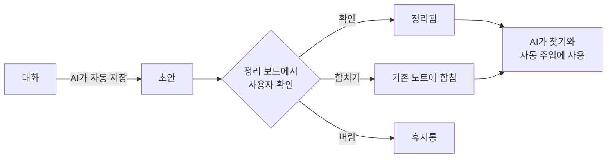
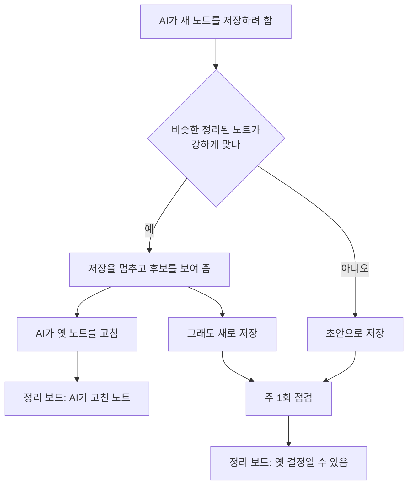
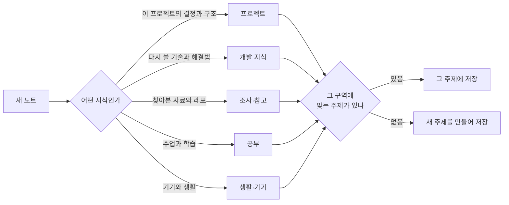

# 프롬프트 이후 설계서 (v2 계획)

- **작성**: 2026-11-13 · **상태**: 사용자 결정 20개 반영([9절](#9-결정-기록과-다음-확인-사항)), 구현 전
- **자리**: 개발 기준은 계속 [설계서](설계서.md)(v1.3.39)다. 이 문서에는 교수님 프롬프트를 받은 뒤 **바꾸는 것과 더하는 것만** 적는다. 항목을 만들기 시작할 때 설계서의 해당 절을 먼저 고친다.
- **근거**: [교수님시스템_비교분석](교수님시스템_비교분석.md)(대조), [기능검토](기능검토.md) 6절(측정), [발표준비](발표준비.md) "보여 줄 숫자"

## TL;DR

1. 교수님 프롬프트의 원칙 "자동은 제안까지, 확정은 사람이"를 받아, **확인 전 초안이 AI의 근거로 쓰이는 길을 닫는다.**
2. 프롬프트 전에 만든 것의 좋은 점 3가지(숫자로 증명, 앱 화면, 한국어 검색)는 **늘리고**, 나쁜 점 9가지는 **줄인다.**
3. 12/08까지 순서는 약점 보완(11/21까지) → 폴더 구조 → 페르소나 질문 → 신경망 보기다.

이 문서에서 쓰는 말:

> **초안**: AI가 저장했지만 사용자가 아직 확인하지 않은 노트. 앱 정리 보드의 "정리 대기"에 보인다.
>
> **정리됨**: 사용자가 확인한 노트.
>
> **실수 노트**: 사용자가 AI를 고쳐 준 말을 "언제 → 무엇을" 규칙으로 남긴 것. 세션을 시작할 때 AI에게 목록으로 전달된다.
>
> **요청 훅**: 사용자가 질문을 보낼 때마다 도는 작은 프로그램. 질문에 맞는 노트와 규칙을 AI에게 미리 붙여 준다.
>
> **구역**: 이번에 새로 두는 맨 위 폴더(프로젝트, 개발 지식 등). 주제 폴더는 구역 아래에 둔다.

## 1. 배경과 범위

### 1.1 왜 다시 설계하나

- 11/13에 교수님 프롬프트를 받았다. AI에 붙여 넣으면 md 폴더·규칙 파일·자동 작업을 만들어 주는 **설치 프롬프트**다.
- 가장 큰 차이는 자동으로 써도 되는 곳의 경계다. 교수님은 자동으로 쌓이는 것이 일지와 **제안**뿐이고, 우리는 AI가 쓴 초안이 확인 전에도 지식처럼 쓰인다.
- 우리 쪽 측정(기능검토 6절)도 같은 곳을 가리킨다: 옛 결정이 남고(3번 중 2번), 규칙이 30개를 넘으면 최근 규칙이 전달되지 않는다(10개 중 0개).

### 1.2 범위

| 구분 | 내용 | 절 |
|---|---|---|
| 넣는다 | 약점 보완 6가지 | [4절](#4-나쁜-점-줄이기-1116--1121) |
| 넣는다 | 새 기능 4가지(폴더 구조, 페르소나 질문, 신경망 보기, 프로젝트 문맥) | [5절](#5-새로-넣는-것-1122--1203) |
| 안 넣는다 | 교수님 방식 가운데 따르지 않기로 한 것, 마감 뒤로 미룬 것 | [8절](#8-하지-않는-것-미루는-것-위험) |
| 그대로 | 설계서 9.1의 남은 작업(서버 배포 뒤 시험, 설치 파일 새 계정 시험, 공격 시험, 주간 보고, 마무리) | 설계서 9.1 |

## 2. 프롬프트 전에 만든 것 평가

### 2.1 좋은 점 — 늘린다

사용자가 고른 세 가지다(11/13).

| 좋은 점 | 프롬프트 전 근거 | 이번에 늘리는 방법 |
|---|---|---|
| 숫자로 증명 | 쓰는/안 쓰는 216번 비교(맞는 답 2 → 24번). 약점도 숫자로 찾음(K-41, K-42) | 보완마다 고치기 전·후를 같은 방법으로 잰다([6.1](#61-고치기-전후-측정)). 주간 보고에 그 숫자를 쓴다 |
| 앱 화면 | 그래프·구조 목록·타임라인·정리 보드. 노트 1만 개 첫 표시 0.78초 | 확인·합치기·되돌리기를 정리 보드 한 곳에서 한다(4.2~4.4). 신경망 보기(5.3)와 폴더 정리 화면(5.1)을 더한다 |
| 한국어 검색 | 질문 30개 중 96.7%를 5위 안에 찾음. 노트 1만 개에서 38ms | 같은 엔진을 "비슷한 노트 표시"(4.2), "저장 때 안내"와 "옛 결정 후보"(4.4)에 다시 쓴다 |

### 2.2 좋은 점 — 그대로 지킨다

- **교정 안전장치**(회귀 시험, 안전 검사): 넓히지 않고 지금 수준을 유지한다(사용자 결정).
- **쓰기 안전·보안, 버튼 하나 설치, 낮은 숨은 비용(+6%), 시험 체계**: 새 기능이 이것을 깨지 않는지 [6.2](#62-지켜야-할-조건)에서 확인한다.

### 2.3 나쁜 점 — 줄인다

| # | 나쁜 점 | 근거 | 줄이는 방법 |
|---|---|---|---|
| B1 | 확인 전 초안이 다른 AI의 근거로 쓰인다 | 초안이 찾기 결과와 자동 주입에 나옴(피드백기록 14) | [4.1](#41-초안을-지식과-분리) |
| B2 | 정리 대기에서 중복인지 직접 찾아야 한다 | 초안 18개 대기(11/12), "이미 있음" 표시 없음 | [4.2](#42-정리-대기-카드에-비슷한-노트-표시) |
| B3 | AI가 확인된 노트를 고쳐도 사용자가 모른다 | 측정에서 확인 없이 바로 고침(기능검토 6-3) | [4.3](#43-ai가-고친-노트-목록과-되돌리기) |
| B4 | 결정이 바뀌어도 옛 노트가 남는다 | K-42: 3번 중 2번은 옛 결정과 새 결정이 함께 남음 | [4.4](#44-바뀐-결정-잡기) |
| B5 | 규칙이 30개를 넘으면 최근 규칙이 전달되지 않는다 | K-41: 최근 10개 중 0개 전달 | [4.5](#45-실수-노트-최근순과-30개-알림) |
| B6 | 주제 폴더가 들쭉날쭉하다 | 주제 13개 중 하나에 노트 38개, 8개 주제는 1~3개(11/13 셈) | [5.1](#51-지식-폴더-구조-고정-구역--주제) |
| B7 | 사용자 정보를 AI가 추측한다 | `_profile.md`가 자동 생성("자주 받은 교정"), 사용자 금지 목록 없음 | [5.2](#52-페르소나-질문-4문항) |
| B8 | 그래프가 그물 모양 하나뿐이다 | 사용자 바람: 완전연결 신경망처럼 보이게(11/13) | [5.3](#53-신경망-보기) |
| B9 | 프로젝트 폴더에서 열어도 같은 안내만 들어간다 | 세션 시작 안내가 프로젝트와 무관 | [5.4](#54-프로젝트-문맥-여유-있으면) |

### 2.4 나쁜 점 — 이번에는 미룬다

- **지식 품질을 잰 적 없음(W1)**: 기능이 아니라 측정이다. 사용자가 초안 18개를 판정한다([6.1](#61-고치기-전후-측정)).
- **날짜별 일지 없음**: 마감 뒤(사용자 결정).
- **앱 안 AI 질문 미검증, Codex 보류**: 설계서 9.1과 미결정 7 그대로다.

## 3. 바뀐 뒤의 흐름

### 3.1 대화에서 나온 지식이 쓰이기까지



초안은 사용자가 확인하기 전까지 G(AI 사용)로 가지 않는다. 지금은 B에서 바로 G로 간다.

### 3.2 결정이 바뀌었을 때



### 3.3 새 노트가 들어갈 자리



## 4. 나쁜 점 줄이기 (11/16 ~ 11/21)

### 4.1 초안을 지식과 분리

- **목적**: 틀린 초안이 다음 대화의 근거가 되는 길(B1)을 닫는다.
- **지금**: 초안이 `[초안]` 표시만 붙어 `brain find` 결과와 요청 훅의 자동 주입에 나온다. `brain add`에 `--draft`를 빼면 바로 정리됨으로 저장된다.
- **바꾸는 것**:
  1. `brain find` 기본 결과에서 초안을 뺀다. `--drafts`를 주면 포함한다.
  2. 결과가 0개인데 맞는 초안이 있으면 "확인 전 초안 N개 있음" 한 줄을 붙인다.
  3. 요청 훅의 자동 주입과 관련 노트 줄에서 초안을 뺀다. 앱 안 AI 질문의 근거 노트에서도 뺀다(지금 초안이 들어가는지는 만들 때 확인한다).
  4. AI 세션 안에서 부른 `brain add`는 `--draft`가 없어도 초안으로 저장한다(문장이 아니라 명령이 강제한다).
  5. 대화 중 자동 저장은 그대로 둔다. 앱의 사람용 검색(⌘K, 노트 표)에는 초안이 계속 보인다.
- **왜 이 방식인가**:
  - 대안 "묻고 저장"(교수님 방식): 매번 답해야 해서 미채택. 자동 저장은 11/07 사용자 요청이다.
  - 대안 "지금 그대로": 표시만으로는 AI가 근거로 쓰는 것을 못 막아 미채택.
  - 채택: 저장은 자동, **사용은 확인 뒤**.
- **바뀌는 곳**: `packages/brain_cli/lib/src/commands/note_commands.dart`(find·add), `hook_command.dart`(자동 주입), `packages/brain_core/lib/src/chat/chat_context.dart`, 스킬 `brain-save`(저장 전 찾기는 `--drafts`로)
- **끝난 기준**: 틀린 초안 1개를 넣고 관련 질문 10개를 보냈을 때 초안이 AI에게 간 횟수가 0이다. 같은 노트를 확인하면 다시 나온다(시험이 실제로 도는지 대조).

### 4.2 정리 대기 카드에 비슷한 노트 표시

- **목적**: 초안을 확인할 때 "이미 있는 내용인가"를 직접 찾는 수고(B2)를 줄인다.
- **바꾸는 것**:
  1. 정리 대기 카드에 비슷한 정리된 노트를 최대 2개 보여 준다(제목, [옆에 열기]).
  2. [합치기]: 초안 내용을 기존 노트에 붙이고, 초안은 "합쳐짐"으로 남긴다(지우지 않음).
- **방법**: 이미 있는 추천 연결 점수(핵심 단어 5개 중 겹친 수)를 쓴다. AI 호출이 없다.
- **바뀌는 곳**: `lib/features/home/board_view.dart`, `packages/brain_core/lib/src/index/search_index.dart`(추천 연결)
- **끝난 기준**: 일부러 만든 중복 초안 10개 중 표시된 수와, 중복이 아닌 초안 10개 중 잘못 표시된 수를 남긴다. 표시 문턱은 이 숫자로 정한다.

### 4.3 AI가 고친 노트 목록과 되돌리기

- **목적**: AI가 확인된 노트를 고쳤을 때 사용자가 알고 되돌릴 수 있게 한다(B3).
- **바꾸는 것**: 정리 보드 "점검 필요" 칸에 "AI가 고친 노트" 카드를 둔다. 카드에는 언제·어느 대화에서 고쳤는지, [바뀐 내용 보기], [되돌리기], [확인함]이 있다.
- **왜 이 방식인가**:
  - 대안 "승인해야 고쳐짐": 승인 전까지 옛 내용이 남고 확인할 일이 늘어 미채택(사용자 결정).
  - 채택: 바로 고치되 눈에 보이게 하고 되돌릴 수 있게 한다.
- **방법**: 변경 기록(`_log/`)과 되돌리기 묶음(`_meta/undo/`)이 이미 있다. 새로 저장하는 것은 "확인함" 표시뿐이다.
- **끝난 기준**: 사본에서 확인된 노트를 `brain write`로 고치면 카드가 뜬다. [되돌리기] 뒤 본문이 고치기 전과 같다.

### 4.4 바뀐 결정 잡기

- **목적**: 결정을 바꿨는데 옛 노트가 남아 AI가 옛 결정을 믿는 문제(B4)를 줄인다.
- **바꾸는 것 (가) 저장 때 안내**:
  1. `brain add`가 저장 전에 비슷한 정리된 노트를 찾아 최대 3줄로 보여 준다.
  2. 강하게 맞으면 저장을 한 번 멈춘다. AI는 옛 노트를 고치거나(`brain write`), `--new`로 새로 저장한다.
- **바꾸는 것 (나) 주 1회 점검**:
  1. 앱이 주 1회(또는 [지금 점검] 버튼) 최근 7일의 새 노트·고친 노트마다 같은 주제의 더 오래된 비슷한 노트를 짝짓는다. AI 호출이 없다.
  2. 정리 보드 "점검 필요" 칸에 "옛 결정일 수 있음" 카드로 띄운다: [옛 노트 보관], [둘 다 맞음], [열어 보기].
  3. [옛 노트 보관]은 옛 노트를 "합쳐짐"으로 바꾸고 새 노트를 가리키게 한다. [둘 다 맞음]을 누른 짝은 다시 묻지 않는다.
- **왜 이 방식인가**:
  - 근거: K-42 측정에서 옛 노트가 AI 눈앞에 온 1번은 고쳐졌고, 안 온 2번은 둘 다 남았다. 그래서 저장 전에 보여 주는 것이 핵심이다.
  - 대안 "AI 주간 정리"(교수님의 dreaming): 더 잘 잡지만 사용량이 들고 작업이 커서 마감 뒤로 미룬다(사용자 결정).
  - 반론: 비슷하지만 다른 노트에서 멈추면 대화가 한 번 길어진다. 그래서 멈춤은 강하게 맞을 때만 하고, 문턱은 측정으로 정한다.
- **바뀌는 곳**: `note_commands.dart`(add), `packages/brain_core/lib/src/lint/linter.dart`(옛 결정 후보), `board_view.dart`, 스킬 `brain-save`
- **끝난 기준**: 결정을 바꾸는 대화 6개로 다시 쟀을 때, 옛 결정이 아무 표시 없이 남은 채 끝나는 것이 6개 중 1개 이하다(지금은 3개 중 2개).

### 4.5 실수 노트: 최근순과 30개 알림

- **목적**: 가장 최근에 고쳐 준 규칙이 AI에게 전달되게 한다(B5).
- **바꾸는 것**:
  1. 세션 시작 목록의 순서를 번호 순에서 **최근에 만들었거나 다시 교정된 순**으로 바꾼다. 30개를 넘으면 가장 오래되고 다시 교정된 적 없는 규칙부터 빠진다.
  2. 적용 중 규칙이 30개를 넘으면 앱 [배운 것]에 "합치기 필요"를 띄우고, 비슷한 규칙 쌍을 보여 준다. 사용자가 두 규칙을 한 문장으로 합친다.
  3. 새 규칙은 지금처럼 바로 적용한다(사용자가 실제로 한 말이 근거이고 안전 검사를 통과한 것만).
- **왜 이 방식인가**:
  - 대안 "모두 승인 뒤 적용"(교수님 방식): 승인 전에 같은 실수가 반복될 수 있어 미채택(사용자 결정).
  - 대안 "프로젝트별 규칙": 더 근본적이지만 만드는 양이 늘어 마감 뒤로 미룬다.
- **바뀌는 곳**: `hook_command.dart`의 `lessonLines`, `lib/features/lessons/lessons_page.dart`
- **끝난 기준**: 규칙 40개인 시험 폴더에서 최근 10개가 세션 시작 안내에 10개 모두 들어간다(지금 0개). 안내 글자 수도 함께 남긴다.

### 4.6 비밀값: GitHub 연결 경고

- **목적**: 지식 폴더가 GitHub로 올라가는 일을 막는다. 교수님의 "GitHub에 안 올라가게"를 우리 쪽에 맞춘 것이다.
- **바꾸는 것**: `brain doctor`와 앱 연동 화면의 점검이, 지식 폴더가 원격 저장소가 있는 git 폴더 안에 있으면 경고한다.
- **그대로 두는 것**: 비밀값은 저장할 때 늘 가린다(사용자 결정). 노트에는 "키가 어디 있는지"만 적는다.
- **끝난 기준**: 원격을 붙인 사본에서는 경고가 나오고, 원격이 없으면 조용하다.

## 5. 새로 넣는 것 (11/22 ~ 12/03)

### 5.1 지식 폴더 구조: 고정 구역 + 주제

- **목적**: 주제 폴더가 들쭉날쭉한 문제(B6)를 없앤다. 새 노트가 들어갈 자리가 예측되게 한다.
- **지금**: `wiki/<주제>/<제목 전체>.md` 한 층이다. AI가 저장할 때 주제를 자유롭게 짓고, AI에게는 기존 주제가 5개만 보인다. 그래서 주제가 계속 새로 생긴다.
- **바꾸는 것**:
  1. **구역 5개를 고정한다**: `프로젝트`, `개발 지식`, `조사·참고`, `공부`, `생활·기기`. 경로는 `wiki/<구역>/<주제>/<파일>.md`다.
  2. 구역은 사용자만 만들고 바꾼다. AI가 모르는 구역으로 저장하려 하면 거절하고 구역 목록을 보여 준다.
  3. **자리 규칙**: 다른 프로젝트에서도 다시 쓸 지식은 `개발 지식/<기술>`에, 그 프로젝트에서만 뜻이 있는 것은 `프로젝트/<이름>`에 둔다([3.3](#33-새-노트가-들어갈-자리)).
  4. AI는 저장 전에 그 구역의 **기존 주제 전체**를 본다. 맞는 주제가 없을 때만 새로 만든다.
  5. **파일 이름은 짧은 한국어 이름**으로 한다(20자 안팎, 특수문자 없이). 긴 제목은 파일 안에 둔다. 예: `SQLite 동시 열기.md`
  6. 한 주제에 노트가 30개를 넘으면 앱이 나누자고 제안한다.
- **기존 노트 86개 옮기기**: 앱 [폴더 정리] 화면이 "노트 / 지금 자리 / 제안 자리 / 제안 이름" 목록을 보여 준다. 사용자가 한 번에 또는 골라서 승인한다. 실행은 되돌리기 묶음 하나다.
- **제안의 예** (추정이다. 확정은 사용자가 화면에서 한다):

  | 지금 주제 (노트 수) | 제안 자리 |
  |---|---|
  | 세컨드브레인 개발 (38) | `프로젝트/세컨드브레인` + 다시 쓸 기술 지식은 `개발 지식/<기술>`로 |
  | 한반도감 (13) | `프로젝트/한반도감` |
  | 참고 레포 (8) | `조사·참고/참고 레포` |
  | 맥 관리 (4), 아이폰 (3) | `생활·기기/맥 관리`, `생활·기기/아이폰` |
  | 그 밖 8개 주제 | 화면에서 사용자가 고른다 |

- **왜 이 방식인가**:
  - 대안 "프로젝트 중심": 프로젝트에 안 속하는 지식의 자리가 모호해 미채택.
  - 대안 "지금 구조 + 규칙만": 프로젝트와 일반 지식이 섞인 채 남아 미채택.
  - 대안 "영어 파일 이름"(교수님 방식): 한국어로 훑어보기 어려워 미채택.
  - 파일 이름을 바꿔도 노트끼리의 링크는 제목으로 이어져 있어 깨지지 않는다(설계서 5.5).
- **바뀌는 곳**: `packages/brain_core/lib/src/note/note_store.dart`(add·move), `file_name.dart`, `search_index.dart`(주제 계산), `hook_command.dart`(주제 목록), `lib/shared/sidebar.dart`, 새 명령 `brain topics`·`brain move`
- **끝난 기준**: [6.1](#61-고치기-전후-측정)의 폴더 지표가 좋아지고, 옮긴 뒤 노트 수 86개·죽은 링크 0개·검색 정확도 96.7%가 그대로다.

### 5.2 페르소나 질문 4문항

- **목적**: 사용자 정보를 AI 추측이 아니라 사용자가 직접 말한 것으로 둔다(B7).
- **바꾸는 것**: 앱 [연동] 다음 단계에 4문항을 둔다. 모두 건너뛸 수 있고 [설정]에서 고친다.

  | # | 질문 | 답이 쓰이는 곳 |
  |---|---|---|
  | 1 | 지금 하는 일 한 줄 | 세션 시작 안내 한 줄(설명 수준) |
  | 2 | 주로 남길 것(여러 개 고르기) | 자동 저장이 먼저 거둘 지식, 구역 처음 구성 |
  | 3 | 답 방식(짧게 결론 먼저 / 자세히 단계별) | 세션 시작 안내 한 줄 |
  | 4 | 절대 저장하면 안 되는 것(자유 입력) | `brain add`·`brain write`가 저장을 막음 |

- **저장**: 지식 폴더의 `me.md`. 사용자가 쓴 것만 담고, 자동 작업은 고치지 않는다.
- **함께 바꾸는 것**: `_profile.md`에서 AI가 추측한 줄("자주 받은 교정")을 뺀다. 주제 통계만 남긴다.
- **묻지 않는 것**: 나이, 성별, 건강, 가족. AI 행동을 바꾸지 않고 파일이 평문이기 때문이다(교수님 프롬프트와 같은 기준).
- **왜 4문항인가**: 교수님처럼 10~14문항이면 맞춤은 자세해지지만 설치가 길어진다. 지금 강점인 "버튼 하나 설치"를 지키려고 4문항으로 했다(사용자 결정).
- **끝난 기준**: 금지어가 든 노트 5개가 모두 막히고, 금지어가 없는 노트 5개는 하나도 막히지 않는다. 세션 시작 안내가 늘어난 글자 수를 남긴다.

### 5.3 신경망 보기

- **목적**: 지식이 흐르는 모습을 완전연결 신경망처럼 보여 준다(B8).
- **자리**: 그래프 보기 안의 [그물 | 신경망] 전환 버튼. 지금 그래프는 그대로 둔다.
- **층** (실제 지식 폴더 기준):

  ```text
  입력층              은닉층             출력층
  대화·자료 15개  →   노트 86개     →   주제 13개
  ```

- **선**: 모두 실제 관계다. 대화 → 노트는 "이 대화에서 나온 노트"(85개), 노트 → 주제는 "속한 주제"(진하게)와 "링크로 이어진 이웃의 주제"(흐리게)다.
- **배치**:
  1. 은닉층은 칸을 나누지 않는다. 층 높이에 맞춰 간격을 좁힌다(사용자 결정). 86개면 간격 약 9px, 1만 개면 빽빽한 띠가 된다.
  2. 같은 주제, 같은 대화에서 나온 노트끼리 붙여 세워 선이 덜 엉키게 한다.
  3. 확대하면 간격이 벌어진다. 이름표는 확대했을 때와 마우스를 올린 노트만 보인다.
- **효과**: 노드를 고르면 대화 → 노트 → 주제로 이어지는 길만 밝아지고 빛이 한 번 흐른다. 나머지는 흐려진다.
- **만드는 순서**: HTML 시안을 먼저 만들어 사용자가 본 뒤 구현한다(초반 설계 때와 같은 방식, 세컨드 브레인 n_0086).
- **왜 이 방식인가**:
  - 대안 "핵심 단어층 추가": 선은 더 촘촘하지만 단어 조각이 점으로 떠서 미채택.
  - 대안 "기본 화면 교체": 지금 그래프의 탐색 기능을 가려 미채택.
- **바뀌는 곳**: `lib/features/home/graph_view.dart`(전환, 그리기), `packages/brain_core/lib/src/graph/`(층 배치)
- **끝난 기준**: 노드 수가 실제 수와 같다(15/86/13). 노트 1만 개에서 첫 표시 시간을 재서 1초 목표와 비교한다. 화면은 사용자가 눈으로 확인한다.

### 5.4 프로젝트 문맥 (여유 있으면)

- **목적**: 프로젝트 폴더에서 AI를 열면 그 프로젝트의 지금 상태와 다음 할 일을 바로 알게 한다(B9).
- **바꾸는 것**: `프로젝트/<이름>/index.md`에 경로, "지금 상태", "다음 할 일"을 둔다. 세션 시작 훅이 작업 폴더가 그 경로 아래면 두 절만 넣는다. AI 호출이 없다.
- **조건**: 12/02~03에 시간이 남을 때만 만든다. 안 되면 마감 뒤로 넘긴다(사용자 결정).

## 6. 검증 기준과 지켜야 할 조건

### 6.1 고치기 전·후 측정

"지금" 값이 비어 있는 것은 고치기 전에 먼저 잰다.

| # | 무엇을 | 방법 | 지금 | 목표 | 비용 |
|---|---|---|---|---|---|
| M2 | 초안 오염 | 틀린 초안 1개 + 관련 질문 10개 → 초안이 AI에게 간 횟수 | 재기 전 | 0/10 | 무료 |
| M3 | 바뀐 결정 | 결정을 바꾸는 대화 6개를 실제 AI로 저장 | 3개 중 2개 남음 | 6개 중 1개 이하 | 약 1~2달러 |
| M4 | 규칙 전달 | 규칙 40개 폴더에서 최근 10개가 전달된 수 | 0/10 | 10/10 | 무료 |
| M5 | 중복 표시 | 중복 초안 10개 중 표시 / 아닌 10개 중 오표시 | 표시 없음 | 재서 문턱 결정 | 무료 |
| M6 | 폴더 | 노트 1~3개짜리 주제 수, 가장 큰 주제, 30자 넘는 파일 이름 | 8/13, 38개, 37/86 | 줄어듦, 30개 이하, 0 | 무료 |
| M7 | 검색 유지 | 질문 30개 정확도, 1만 개 찾기 시간 | 96.7%, 38ms | 그대로 | 무료 |
| M8 | 신경망 보기 | 1만 개 첫 표시 시간 | 없음 | 1초 목표 | 무료 |
| W1 | 지식 품질 | 사용자가 초안 18개를 쓸모 있음·없음·틀림으로 판정 | 미측정 | 첫 측정 | 사용자 시간 |

교수님 방식과의 찾기 비교(실제 AI 60번)는 하지 않는다(사용자 결정).

### 6.2 지켜야 할 조건

- **속도**: 초안 분리와 저장 때 안내를 넣은 뒤에도 노트 1만 개에서 찾기 50ms, 훅 100ms 목표를 지킨다.
- **숨은 비용**: 세션 시작 안내가 길어진 글자 수를 재서 남긴다(주제 목록, `me.md` 한 줄).
- **안전**: 폴더 옮기기는 되돌리기 묶음 하나로 한다. 시험은 지식 폴더 사본에서만 한다. 실제 폴더에 적용하는 것은 사용자 승인 뒤다.
- **호환**: 노트 형식과 번호(id)는 그대로다. 바뀌는 것은 폴더와 파일 이름뿐이다.
- **기본기**: 긴 작업(옮기기, 점검)에는 진행 표시와 오류 안내를 둔다.

## 7. 구현 계획

### 7.1 일정 (안)

| 날짜 | 할 일 | 측정 |
|---|---|---|
| 11/16(월)~11/17(화) | 4.1 초안 분리, 4.2 비슷한 노트 표시 | M2, M5 |
| 11/18(수) | 4.5 실수 노트 최근순·30개 알림. 사용자: 초안 18개 판정 | M4, W1 |
| 11/19(목) | 2주차 주간 보고 | — |
| 11/20(금)~11/21(토) | 4.4 바뀐 결정, 4.3 AI가 고친 노트, 4.6 GitHub 경고 | M3 |
| 11/22(일)~11/25(수) | 5.1 폴더 구조와 기존 노트 옮기기 | M6, M7 |
| 11/25(수)~11/26(목) | 5.2 페르소나 4문항. 3주차 주간 보고(11/26) | — |
| 11/27(금)~12/01(화) | 5.3 신경망 보기(시안 → 확인 → 구현) | M8 |
| 12/02(수)~12/03(목) | 5.4 프로젝트 문맥(여유 있으면). 4주차 주간 보고(12/03) | — |
| 12/04~12/07 | 마무리(통합 시험, 시연 영상, 결과 보고서) | — |

기능검토 6절에 잡아 둔 K-41(11/18~19), K-42(11/20~21), W1·W3(11/19) 일정은 이 표로 바꾼다.

### 7.2 만드는 원칙

1. **설계서 먼저**: 항목을 시작하기 전에 설계서의 해당 절을 고친다.
2. **시험 먼저**: 고치기 전에 시험이 실패하는 것을 확인하고 고친다.
3. **화면은 시안 먼저**: 신경망 보기와 폴더 정리 화면은 시안을 사용자가 본 뒤 만든다.
4. **실제 지식 폴더는 사본으로**: 시험은 사본에서 하고, 실제 폴더는 사용자 승인 뒤에만 바꾼다.

### 7.3 기존 판 보존 (사용자 요청 11/13)

새 설계로 덮어쓰지 않는다. 기존 판(v1, 프롬프트 전)을 남겨 두고 비교해서, 나으면 새 판을 쓰고 아니면 되돌린다.

| 무엇 | 어떻게 남기나 | 되돌리는 법 | 상태 |
|---|---|---|---|
| 코드·문서 | 커밋 `0adb847`에 git 태그 `v1-프롬프트전`. 새 작업은 새 브랜치 `feat/post-prompt`(같은 커밋에서 시작)에서 한다 | 태그로 돌아가거나 항목 커밋만 되돌린다 | 11/13 만듦(로컬, push 안 함) |
| 기존 앱 | `dist/SecondBrain-0.1.0.dmg`(11/12 빌드)를 `dist/SecondBrain-v1-프롬프트전.dmg`로 보관(SHA-256 `05f39f89…94d2`, 원본과 같음). `dist/`는 git 제외 | 그 파일로 다시 설치 | 11/13 만듦 |
| 실제 지식 폴더 | 폴더 구조를 바꾸기(5.1) 전에 `~/SecondBrain` 전체를 `~/SecondBrain-v1-프롬프트전-20261113`으로 복사(파일 400개, 3MB, `diff -rq` 차이 없음) | 사본으로 바꿔 넣는다 | 11/13 만듦. 5.1 직전에 한 번 더 뜬다 |
| 바뀌는 동작 | 4.1(초안 분리)·4.5(규칙 순서)·5.1(폴더)은 설정에 "이전 방식" 스위치를 둔다 | 앱에서 끈다 | 항목을 만들 때 |

- 항목마다 6.1 측정을 기존 판과 새 판에서 같은 방법으로 잰다. 새 판이 나쁘면 그 항목만 되돌린다.
- 설계서(`설계서.md`)는 항목을 만들 때 고치지만, 태그 시점의 v1.3.39가 그대로 남는다.

### 7.4 밀리면 끊는 순서

뒤에서부터 끊는다: 5.4 프로젝트 문맥 → 5.3의 빛 흐름 효과 → 5.2 페르소나 질문 → 5.1의 파일 이름 바꾸기(구역 이동만 남김).

4.1, 4.4, 4.5(약점 세 가지)는 끊지 않는다.

## 8. 하지 않는 것, 미루는 것, 위험

### 8.1 교수님 방식 가운데 따르지 않는 것

| 교수님 방식 | 우리 선택 | 이유 |
|---|---|---|
| 저장 전에 묻는다 | 자동 저장 + 확인 전에는 안 쓰임 | 매번 답하는 수고를 줄인다 |
| 규칙은 승인 뒤 적용 | 사용자 말이 근거면 바로 적용 | 승인 전에 같은 실수가 반복된다 |
| 설치 질문 10~14개 | 4문항 | 버튼 하나 설치를 지킨다 |
| 비밀값을 저장은 허용 | 저장할 때 늘 가림 | 우리 노트는 AI에게 자동으로 들어가 더 넓게 퍼진다 |
| 영어 파일 이름 | 짧은 한국어 이름 | 한국어로 훑어본다 |
| 목차를 따라가 찾기 | 검색 엔진 유지 | 측정된 강점이다 |

교수님 프롬프트는 **문서로만 비교한다. 설치하지 않는다**(사용자 결정 11/13). 메일의 "페르소나 질문에 자세히 답하라"는 프롬프트를 직접 쓸 경우에만 해당하는 안내다.

### 8.2 마감 뒤로 미루는 것

- AI 주간 정리(교수님의 dreaming을 AI로 돌리는 것)
- 날짜별 일지와 주·월 회고
- 프로젝트별 규칙
- Codex 연동(방법만 설계서 미결정 7에 적어 둔다)
- 프로젝트 문맥(12/03까지 못 만들면)

### 8.3 위험과 대응

| 위험 | 대응 |
|---|---|
| 일정과 여력(Claude Max 계정 종료, 마감 12/08) | [7.4](#74-밀리면-끊는-순서)의 순서로 끊는다 |
| 초안 분리 뒤 "방금 저장한 것을 AI가 모른다" | 결과가 0개일 때 초안 안내 한 줄, 정리 보드에 대기 수 표시 |
| 폴더를 옮기다 실제 지식이 망가짐 | 사본으로 시험, 실행은 되돌리기 묶음 하나, 실행 전 확인 창 |
| 옮기기 전의 되돌리기 기록이 옛 경로를 가리킴 | 옮기기 전에 안내하고, 옛 기록은 "경로 바뀜"으로 표시 |
| 비슷한 노트·옛 결정 후보가 헛짚음 | 문턱을 측정으로 정하고, 거절한 짝은 다시 묻지 않음 |
| 신경망 보기가 느리거나 읽기 어려움 | 시안 먼저, 1만 개로 측정 |
| 세션 시작 안내가 길어짐 | 글자 수를 재고, 세션마다 같은 글인지(캐시 재사용) 확인 |
| 금지 목록이 엉뚱한 노트를 막음 | 금지어는 2글자 이상만, 막힌 이유를 보여 줌 |

## 9. 결정 기록과 다음 확인 사항

### 9.1 사용자 결정 (2026-11-13, 질문 20개)

**방향**

| # | 질문 | 결정 |
|---|---|---|
| 1 | 문서 형태 | 새 파일로 따로 쓰고, 만들 때 설계서 절을 고친다 |
| 2 | 만드는 순서 | 약점 먼저 |
| 3 | 초안 원칙 | 초안만 분리(자동 저장 유지) |
| 4 | 늘릴 장점 | 숫자로 증명, 앱 화면, 한국어 검색 |

**나쁜 점 줄이기**

| # | 질문 | 결정 |
|---|---|---|
| 5 | AI가 확인된 노트를 고칠 때 | 고치고 목록에 남김 + 되돌리기 |
| 6 | 실수 노트 적용 | 지금처럼 바로 적용 |
| 7 | 바뀐 결정 | 저장 때 안내 + 주 1회 점검 |
| 8 | 규칙이 많을 때 | 최근순 + 30개에서 합치기 |

**새로 넣을 것**

| # | 질문 | 결정 |
|---|---|---|
| 9 | 페르소나 질문 | 4문항. 덧붙임: 파일 정리와 파일 생성 구조에 갈증이 있다 |
| 10 | 비밀값 | 늘 가림 + GitHub 경고 |
| 11 | 신경망 층 | 대화 → 노트 → 주제 |
| 12 | 신경망 자리 | 그래프 안에서 전환 |

**파일 정리**

| # | 질문 | 결정 |
|---|---|---|
| 13 | 난잡한 곳 | 주제 폴더가 들쭉날쭉 |
| 14 | 폴더 틀 | 고정 구역 + 주제 |
| 15 | 파일 이름 | 짧은 한국어 이름 |
| 16 | 기존 노트 | 앱이 제안, 사용자가 승인 |

**범위와 검증**

| # | 질문 | 결정 |
|---|---|---|
| 17 | 프로젝트 문맥 | 여유 있으면 |
| 18 | 일지 | 마감 뒤 |
| 19 | 측정 범위 | 무료 + 소액 재측정 |
| 20 | 교수님 프롬프트 직접 사용 | 문서 비교만 한다. 설치하지 않는다 |

그 전에 정한 것: 신경망 보기를 넣는다, 은닉층은 칸 없이 간격을 좁힌다(11/13).

### 9.2 AI 권장안으로 채운 세부 (사용자 확인 전)

큰 결정은 위 표대로이고, 아래는 AI가 채운 세부다. 다르게 하려면 말하면 고친다.

- 4.1: AI 세션에서 부른 `brain add`는 늘 초안으로 저장한다.
- 4.2: 정리 대기 카드에 [합치기] 버튼을 둔다.
- 4.4: 비슷한 노트가 강하게 맞으면 저장을 한 번 멈춘다.
- 4.5: 30개를 넘어도 새 규칙은 바로 적용하고, 오래된 규칙이 목록에서 빠진다.
- 5.1: 구역 이름 5개, 자리 규칙, 한 주제 30개에서 나누기 제안.
- 5.2: 금지 목록은 서버로 보내지 않고 기기에서만 검사한다. `_profile.md`의 추측 줄을 뺀다.
- 5.3: 고르면 빛이 흐르는 효과를 넣는다.

### 9.3 다음 확인 사항

- 교수님께: 수업에서 보여 주신 그래프가 어떤 레포·도구인지, "decision"이 무엇인지, raw에 디자인을 넣는 방법, 일요일 19시 작업(뒤의 셋은 프롬프트에 없음).
- 사용자에게: 구역 이름 5개와 주제 대응표(5.1), 이 문서 전체.
