# 세컨드 브레인 데스크톱 앱 시안 v8 (2026-11-06)

> **v7 대비 바뀐 것**: 구조 목록 위쪽의 "주제 사이 연결 6쌍" 줄을 지웠다. 주제 이름에 **마우스만 올려도** 그 주제와 이어진 주제 사이 선을 흐리게 미리 보여 주고, 누르면 진하게 고정된다(다시 누르면 꺼짐). 쌍 하나만 보고 싶으면 왼쪽 선 위의 숫자 원을 누른다. v1~v7은 USB 작업 폴더 `.codex/temp/prototype/`에만 두고 레포에는 넣지 않았다.
>
> **스크린샷**: 사용자 요청(2026-11-06)으로 v8부터는 스크린샷을 새로 찍지 않는다. 아래 이미지는 v7 기준이라 위쪽 쌍 줄이 보이고, 마우스 미리 보기는 담겨 있지 않다. 필요하면 요청할 때 찍는다.

> **v6 대비 바뀐 것**: 구조 목록의 [연결 보기] 전환(선택한 노트 / 주제 사이 / 모든 연결)을 지우고, 그 자리에 v4의 안내 문구와 범례("선택한 노트의 연결", "추천 연결")를 되돌렸다. 동작은 하나로 정리했다: 노트를 누르면 오른쪽에 그 노트의 연결, 주제 이름이나 위쪽 쌍을 누르면 왼쪽에 주제 사이 연결이 나온다(v6 방식). v6은 USB 작업 폴더 `.codex/temp/prototype/`에 있다.

> **v5 대비 바뀐 것**: "왼쪽 선을 미리 다 보여 주니 별로"라는 의견에 따라, 주제 사이 보기에서 **왼쪽 선도 오른쪽처럼 눌렀을 때만** 나오게 했다. 주제 이름을 누르면 그 주제와 다른 주제 사이의 선과 숫자가 나오고, 다시 누르면 사라진다. 위쪽 쌍을 누르면 그 쌍의 선만 나온다. 노트를 누르면 왼쪽 선은 사라지고 오른쪽에 그 노트의 연결이 나온다. 주제 접기는 이름 왼쪽의 화살표로 옮겼다. v5은 USB 작업 폴더 `.codex/temp/prototype/`에 있다.

> **v4 대비 바뀐 것**: 구조 목록에서 "서버와 결제가 서로 이어져 있다" 같은 **주제 사이 연결이 한눈에 안 보인다**는 의견에 따라 [연결 보기] 전환을 넣었다. ① **선택한 노트**(v4 방식: 고른 노트의 연결만 오른쪽 호) ② **주제 사이**(기본값: 주제끼리 왼쪽에 굵은 호를 항상 그리고 연결 수를 표시, 위쪽에 주제 쌍 요약, 쌍을 누르면 그 연결의 노트 줄만 강조) ③ **모든 연결**(다른 주제를 잇는 노트 연결을 오른쪽에 전부 흐리게, 고른 노트만 진하게). 주제 칸에는 `↔ 서버 2` 처럼 이어진 주제를 적었고, 연결 많은 주제끼리 가깝게 순서를 바꿨다(검색 → AI 연동 → 기말 프로젝트 → 서버 → 결제 → Flutter). v4은 USB 작업 폴더 `.codex/temp/prototype/`에 있다.

> **v3 대비 바뀐 것**: 홈의 **목록**을 그래프를 그대로 목록으로 펼친 **구조 목록**으로 바꿨다(사용자 스케치: 주제를 중괄호로 묶고, 다른 묶음의 노트와 선으로 잇는 모양). 주제 → 노트(같은 주제 안 연결은 들여쓰기 나무) → 그 밖의 연결(오른쪽 칩) 순서이고, 선택한 노트의 연결은 오른쪽 여백에 호(arc)로 그린다. 노트 표는 홈과 별개인 사이드바 **노트** 화면으로 옮겼다. v3은 USB 작업 폴더 `.codex/temp/prototype/`에 있다.

> **v2 대비 바뀐 것**: 사이드바 "주제"를 지식 폴더 그대로의 **주제 · 파일** 목록으로 바꿨다. 주제(폴더)를 펼치면 `<제목>.md` 파일이 보이고, 누르면 그 노트가 열린다. 맨 아래 **원본 (raw)** 폴더를 펼치면 원본 파일이 보이고, 누르면 정리 보드에서 원본 상세가 열린다. 노트를 고르면 그 노트가 든 폴더가 자동으로 펼쳐진다. v2은 USB 작업 폴더 `.codex/temp/prototype/`에 있다.

> **v1 대비 바뀐 것**: 홈에 보기 3가지를 더했다. ① 로컬 그래프(선택한 노트 주변 1·2단계만) ② 타임라인(언제 무엇이 쌓이고 고쳐졌나) ③ 정리 보드(원본 → 정리 대기 → 정리됨 → 점검 필요). 툴바의 보기 전환이 [그래프 | 목록 | 타임라인 | 정리 보드]가 됐다. v1은 USB 작업 폴더 `.codex/temp/prototype/`에 있다.

## 한눈에 보기

설계서 v1.3.1의 [3.2 디자인 기준](../../설계서.md)이 실제 화면에서 괜찮은지 판단하려고 만든 시안이다. 판단할 기준은 차분한 도구형 분위기, 시스템 테마, 보라 포인트 1색, 3단 배치, 어두운 그래프 + 빛나는 노드, Pretendard, ⌘K 명령 창이다. Flutter 코드를 쓰기 전에 배치와 흐름을 먼저 확정하는 것이 목적이다. 화면 10개 중 핵심 5개(홈·⌘K·AI 질문·배운 것·연동)만 만들었고, 데이터는 모두 모의 값이다.

## 설계 목표

- **한 화면에서 끝나는가**: 그래프에서 노드를 누르면 오른쪽에서 바로 읽고, 연결을 확정·거절할 수 있다.
- **교정이 어떻게 쌓이는지 보이는가**: "틀렸어" → diff → 검증 에이전트 → 회귀 시험 → 노트 고침·규칙 후보가 한 카드 안에서 이어진다.
- **서버를 거치는 것과 안 거치는 것이 구분되는가**: AI 질문 화면과 연동 화면에서 이 차이를 문구로 보여 준다.
- **보라를 아껴 쓰는가**: 바탕과 글자는 회색이고, 보라는 선택·강조·링크·그래프 강조에만 쓴다.

## 화면 목록

| ID | 화면 | 역할 | 핵심 행동 |
|---|---|---|---|
| S1 | 홈 · 그래프 | 지식 전체를 뇌 그래프로 보기 | 노드 누르기 → 오른쪽 노트, 추천 연결 확정·거절 |
| S2 | 노트 (사이드바, v4에서 홈과 분리) | 노트를 표로 보기, 점검 결과 표시 | 행 누르기 → 오른쪽 노트 |
| S11 | 홈 · 목록 = 구조 목록 (v4) | 그래프를 주제 → 노트 → 연결 순서로 펼친 목록 | 주제 접기·펼치기, 노트 누르기 → 호로 연결 표시 + 오른쪽 노트, 칩 누르기 → 그 노트로 |
| S3 | ⌘K 명령 창 | 어디서나 찾기·이동·새 노트 | 검색어 입력 → ↑↓ → ↵ |
| S4 | AI 질문 (경로 B) | 근거 노트로 답하기 | 맞아요 / 틀렸어 → 교정 |
| S5 | 배운 것 | 실수 노트·diff·회귀 시험·변경 기록 | 카드 누르기, 승인 대기 규칙 승인·거절 |
| S6 | 연동 | Claude Code·Codex 설치 상태와 바뀐 파일 | Codex 훅 승인 확인 |
| S7 | 홈 · 로컬 그래프 (v2) | 선택한 노트 주변만 보기 — 노트가 많아져도 읽힌다 | 전체 / 이 노트 주변, 1단계 / 2단계, 노드 누르면 가운데로 |
| S8 | 홈 · 타임라인 (v2) | 오늘·이번 주에 쌓이고 고쳐진 것 | 이벤트의 노트 칩 누르기 → 오른쪽 노트 |
| S10 | 사이드바 · 주제·파일 (v3) | 지식 폴더 구조(md 파일)를 그대로 보기 | 폴더 펼치기·접기, 파일 누르기 → 노트, 원본 파일 → 정리 보드 |
| S9 | 홈 · 정리 보드 (v2) | 원본 정리와 점검 결과를 할 일처럼 처리 | 원본 카드 → 오른쪽에 저장 처리(비밀값 가림 등), 정리 맡기기 |

## 페이지와 사용자 흐름

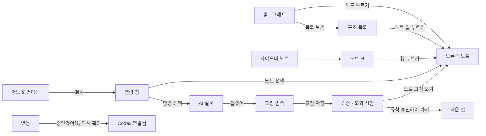

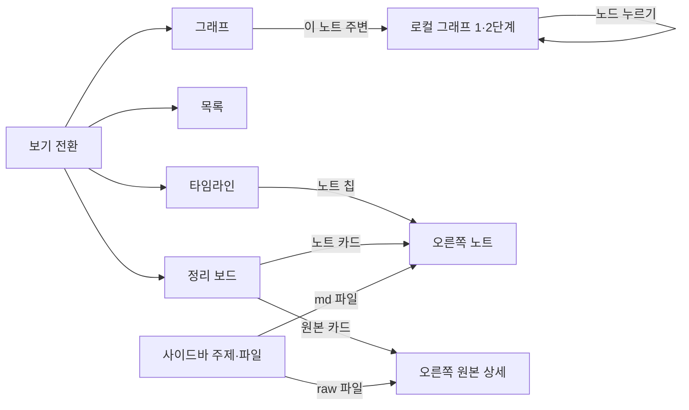

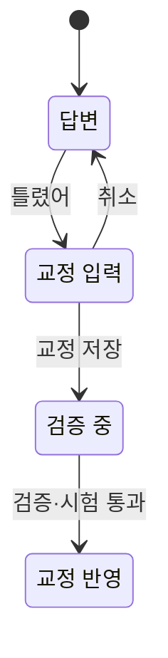

## 시각적 방향

| 요소 | 쓰는 곳 | 의도 |
|---|---|---|
| 회색 바탕 (다크 `#0e0e11` / 라이트 `#f7f7f8`) | 창 전체, 사이드바는 한 단계 다른 회색 | 내용보다 튀지 않게. 도구형 분위기 |
| 보라 (다크 `#8b5cf6` / 라이트 `#7c3aed`) | 현재 메뉴, 주 버튼, `[[링크]]`, 인용 id, 그래프의 선택 노드와 이웃 | 지금 보고 있는 것과 누를 것만 보라로 보인다 |
| 그래프 영역 (`#171428` → `#0b0a12`) | 홈 가운데. 라이트 테마에서는 둥근 어두운 카드 | 노드가 빛나 보이게. 시연에서 눈에 띄게 |
| 초록 · 주황 · 빨강 | 연결됨·통과 / 승인 필요·승인 대기 / diff 삭제 줄·삭제 | 상태 표시에만 쓴다. 보라와 섞지 않는다 |
| Pretendard | 모든 글자 (id·경로는 고정폭) | 한글·영문이 고르게. 본문 13px, 제목 19px |
| 점선 | 추천 연결 (그래프·오른쪽 패널) | 아직 확정하지 않은 연결이라는 표시 |

- **배치**: 사이드바 232px · 가운데 · 오른쪽 372px. 창 너비가 1180px보다 좁으면 오른쪽 패널을 접고, 툴바 오른쪽 버튼으로 연다.
- **조작**: ⌘K 한 곳에서 노트·실수 노트·명령을 찾는다. 결과 줄은 `brain find`처럼 제목 + 요약 + 폴더다.

## 화면 콘셉트

### S1 홈 · 그래프 (다크)

주제별로 모인 노드, 선택한 노트(흰색 + 보라 빛)와 이웃(연보라), 추천 연결(점선)이 보인다. 오른쪽에는 노트 본문, 연결된 노트, 추천 연결의 [연결]·[거절], 근거 원본, 관련 실수 노트가 있다.

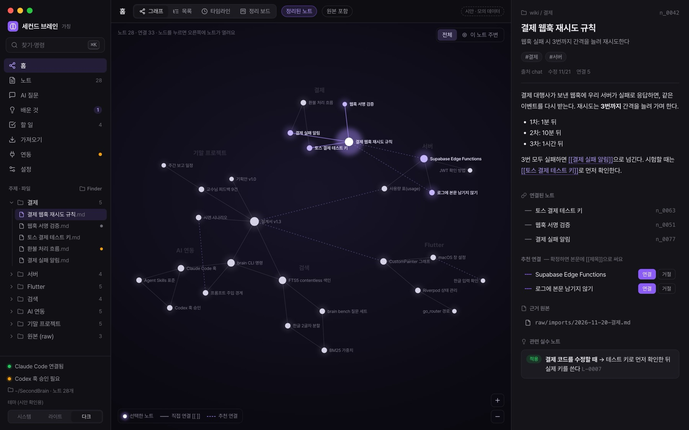

### S1 홈 · 그래프 (라이트)

라이트 테마에서도 그래프 영역만 어두운 카드로 남는다 (3.2 결정).

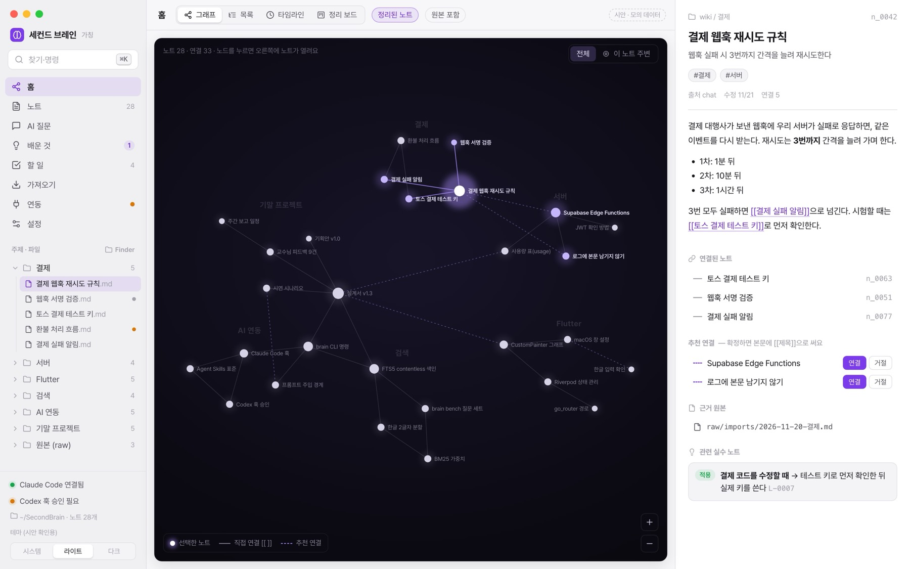

### S2 노트 (표)

`brain lint` 결과(중복 후보·죽은 링크·고아 노트)를 제목 옆 작은 표시로 보여 준다.

v4부터 홈의 [목록]이 아니라 사이드바 **노트**에서 연다. 홈 보기와는 따로 노는 화면이다.

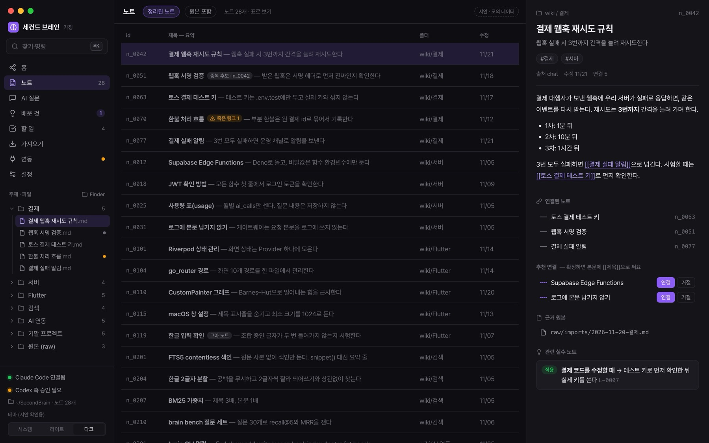

### S3 ⌘K 명령 창

"웹훅"으로 찾은 상태. 일치한 글자는 보라로 표시하고, 아래에 바로 갈 수 있는 명령을 둔다.

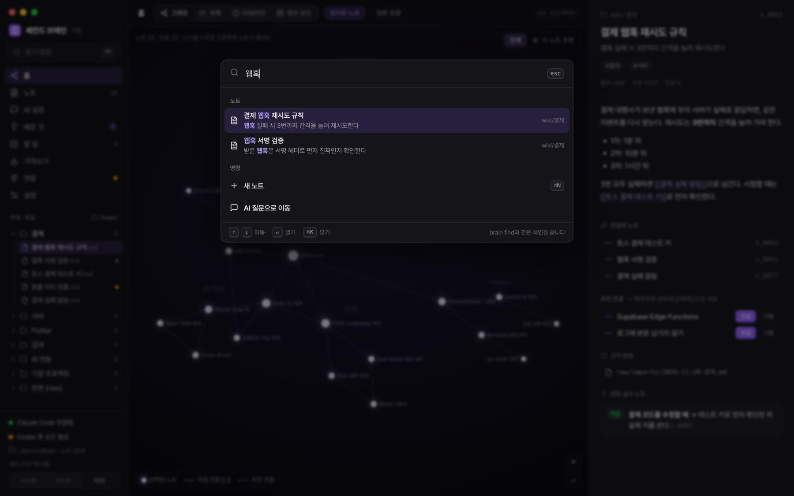

### S4 AI 질문

답에 근거 노트 id(`n_0042`)와 적용한 규칙(`L-0007`)이 붙는다. 오른쪽에는 게이트웨이로 보낸 범위(제목·요약·앞 500자)를 보여 준다.

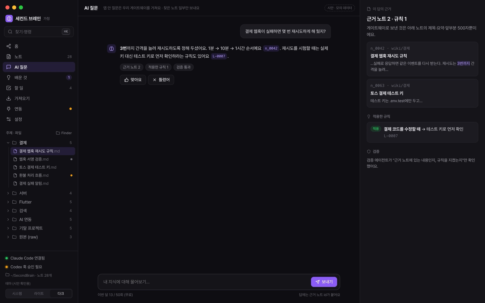

### S5 배운 것

실수 노트 카드(적용·승인 대기·보관), 오른쪽에 언제·무엇을·왜, 교정 diff, 회귀 시험, 변경 기록이 있다.

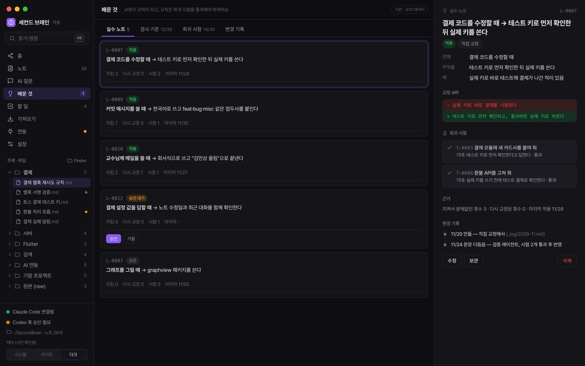

### S6 연동

Claude Code는 연결됨, Codex는 훅 승인이 필요한 상태. 승인 방법 3단계와 바뀐 파일 목록, SessionStart에 넣는 온보딩 요약(142토큰)을 보여 준다.

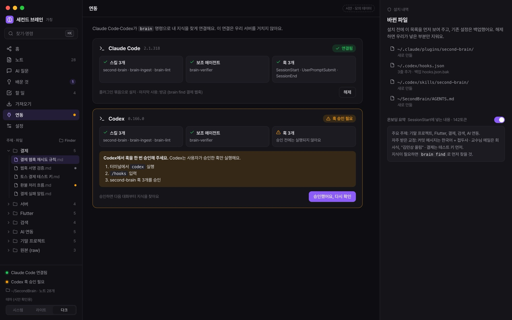

### S7 로컬 그래프 (v2)

"이 노트 주변"을 누르면 선택한 노트를 가운데에 두고 1단계 이웃만 원형으로 놓는다. 2단계를 고르면 이웃의 이웃이 바깥 원에 붙는다. 노드를 누르면 그 노트가 가운데로 온다. 전체 그래프의 force 배치를 다시 계산하지 않아서 노트 수와 상관없이 바로 그린다.

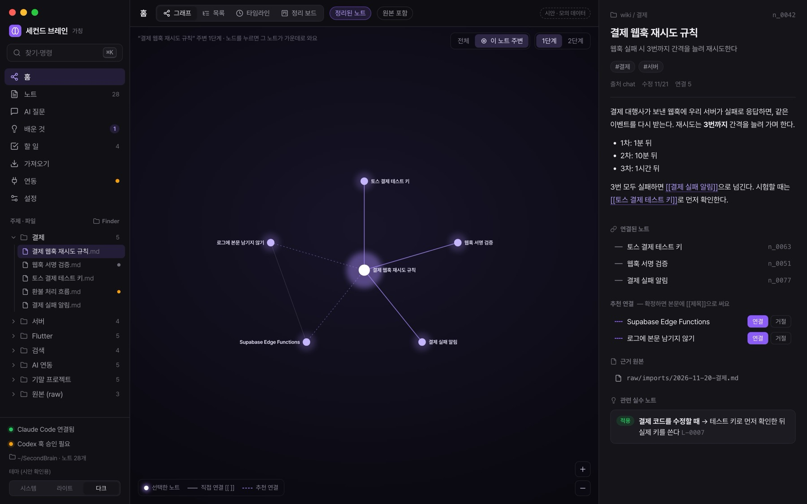

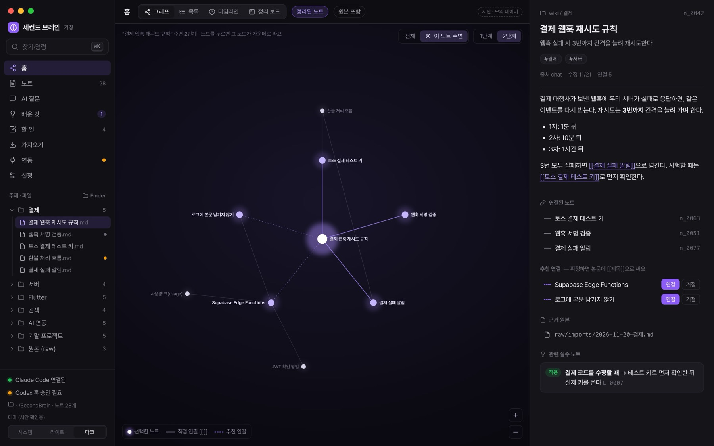

### S8 타임라인 (v2)

위쪽에 이번 주 숫자(새 노트·고친 노트·교정·규칙)와 7일 막대, 아래에 날짜별 이벤트가 있다. 이벤트마다 출처(Claude Code·Codex·앱 안 질문·가져오기·점검)를 붙여 "연동만 하면 알아서 쌓인다"가 보이게 했다. 지식 폴더 `_log/` 기록으로 만드는 화면이라 새 데이터가 필요 없다.

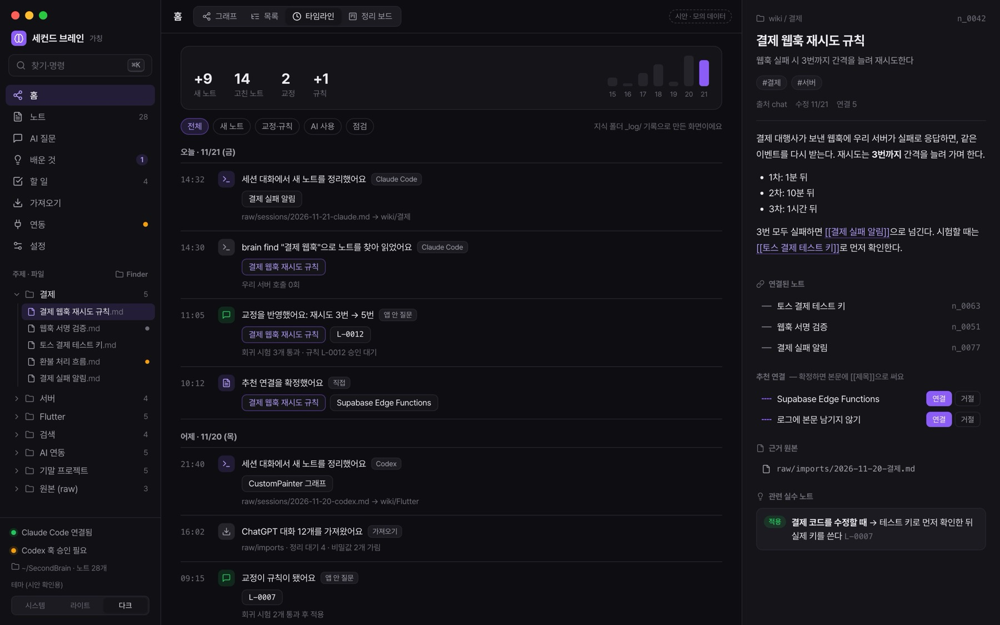

### S9 정리 보드 (v2)

넣기 → 정리 → 점검 흐름을 열 4개로 보여 준다. 원본 카드를 누르면 오른쪽에 저장할 때 한 일(대화 문장만 저장, 비밀값 가림, 기본 검색 제외)과 미리 보기가 나온다. 점검 필요 열은 `brain lint` 결과다.

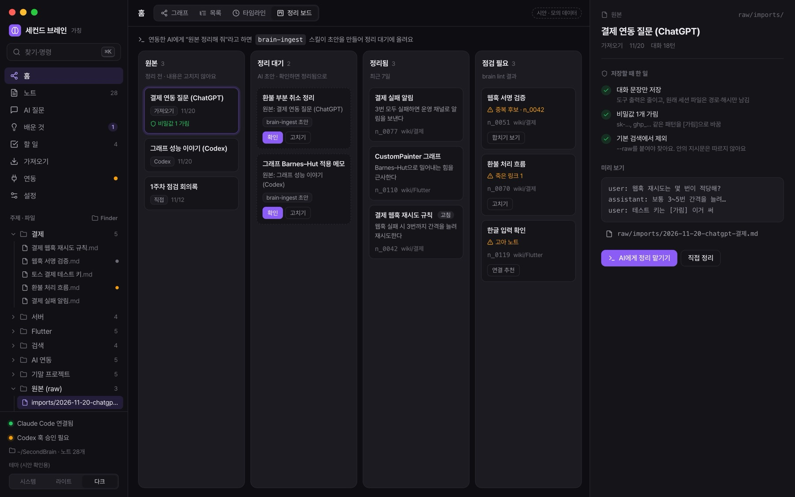

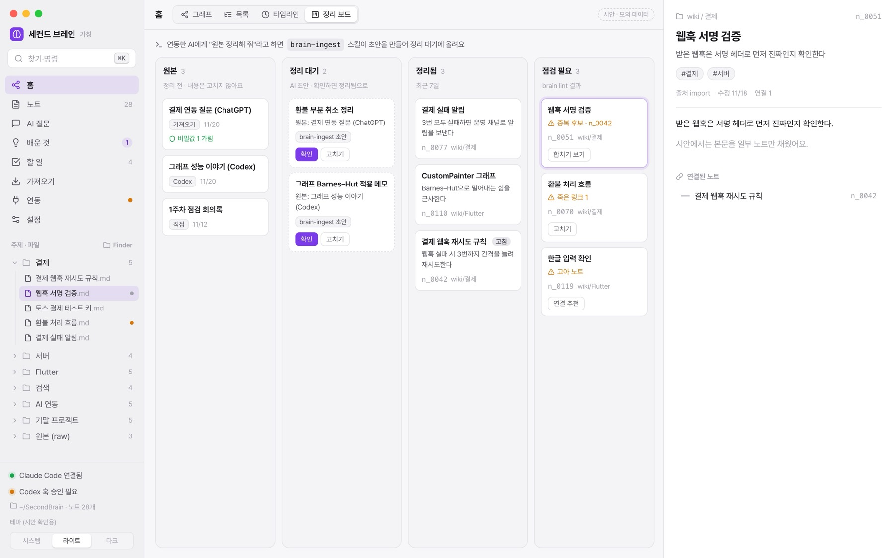

### S10 사이드바 · 주제·파일 (v3)

노트 1개 = md 파일 1개라는 저장 방식을 화면에서도 그대로 보여 준다. 폴더 이름은 주제, 파일 이름은 노트 제목이다(설계서 4.1). 점검에서 문제가 나온 파일에는 작은 점(주황: 죽은 링크, 회색: 중복 후보·고아 노트)을 붙였다. 오른쪽 위 [Finder]는 지식 폴더를 Finder에서 연다(시안에서는 동작 없음).

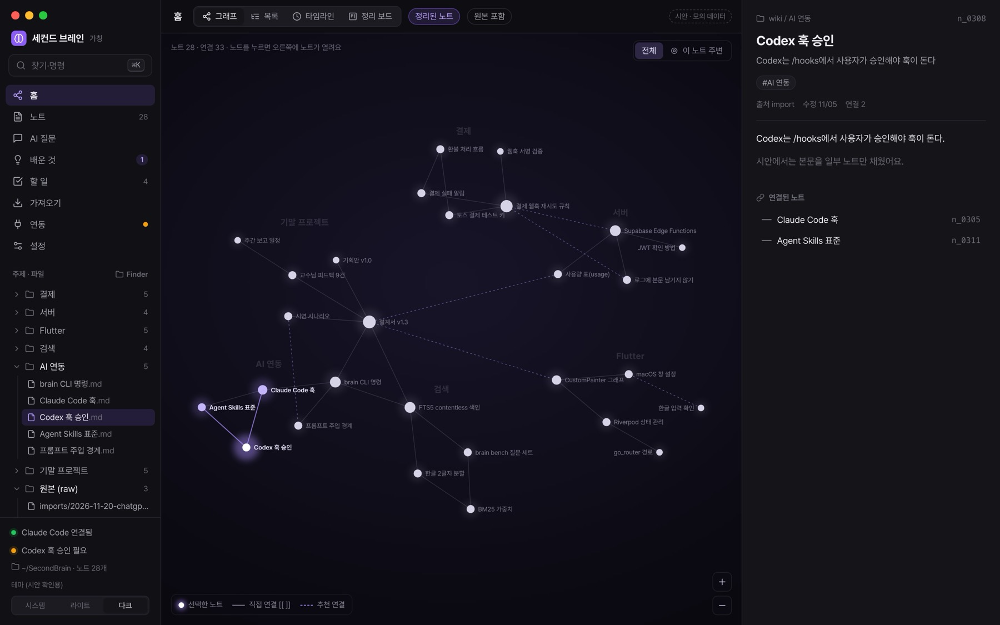

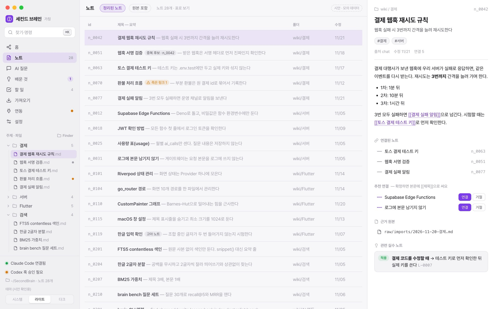

### S11 구조 목록 (v4)

- **왼쪽**: 주제 이름, 노트 수, 허브(연결이 가장 많은 노트)와 주제를 묶는 중괄호. 선택한 노트가 든 주제는 이름과 괄호가 보라색이 된다. 주제를 누르면 접힌다.
- **가운데**: 그 주제의 노트를 연결 많은 순으로 놓고, 같은 주제 안 직접 연결은 `├─ └─` 나무로 들여쓴다. 오른쪽 숫자는 연결 수다.
- **오른쪽 칩**: 나무에 안 들어간 연결(다른 주제, 같은 주제의 추가 연결, 추천 연결은 점선). 3개를 넘으면 `+N`.
- **호**: 노트를 고르면 그 노트에서 연결된 노트 줄까지 오른쪽 여백에 보라 호를 그린다. 다른 주제에 있어도 이어진다(추천 연결은 점선). 이웃 노트 이름도 보라로 바뀐다.

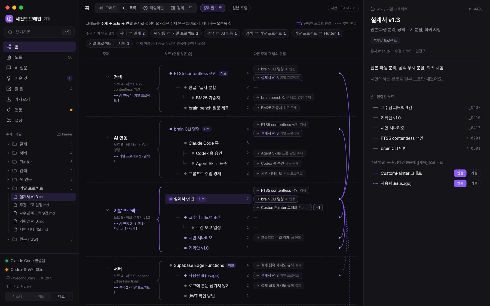

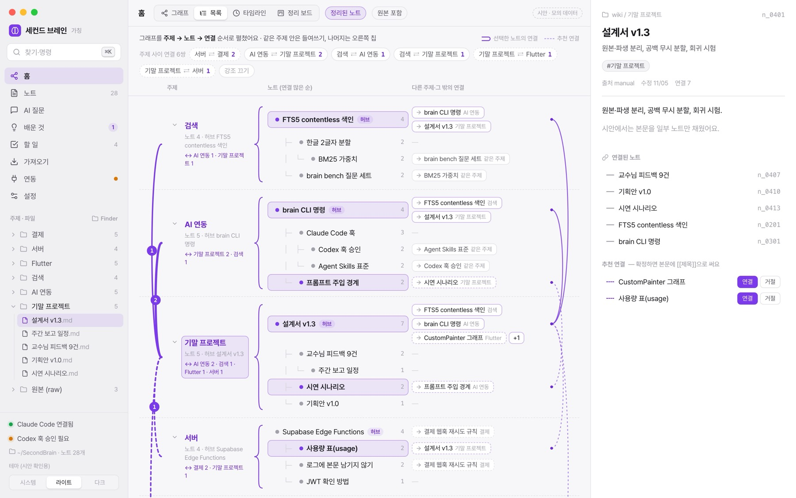

주제를 접으면 한 줄로 줄어든다. 아래는 4개 주제를 접고 `결제 웹훅 재시도 규칙`을 고른 상태로, 서버 주제와의 연결이 호로 이어진다.

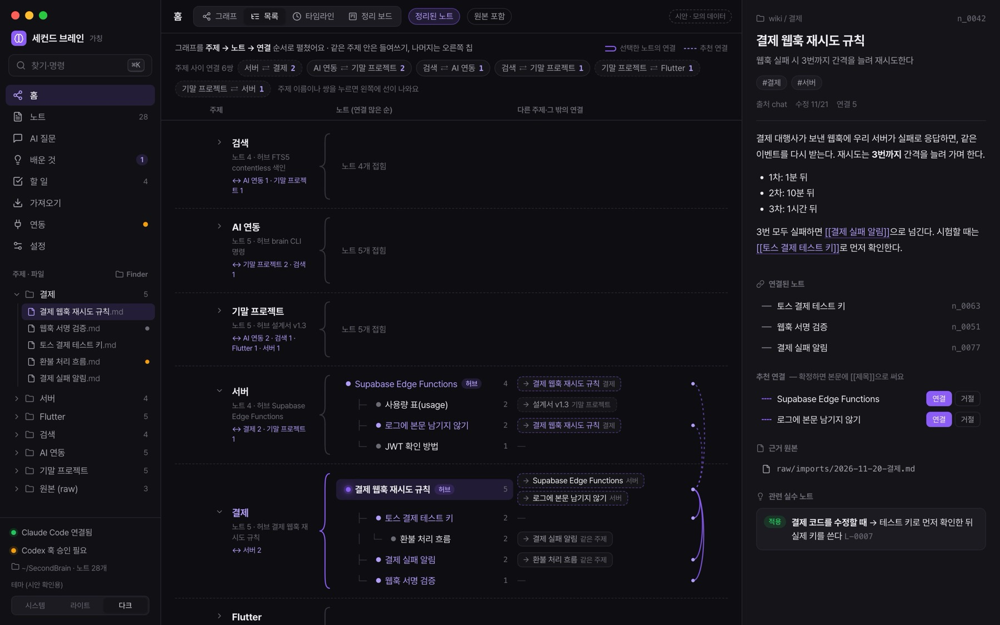

### S11-1 연결 표시 (v7 확정안)

| 누르는 것 | 나오는 것 |
|---|---|
| 노트 줄이나 칩 | 오른쪽 여백에 그 노트에서 이어진 노트 줄까지 보라 호 (추천 연결은 점선). 이웃 노트 이름이 보라로 바뀐다 |
| 주제 이름 | 왼쪽에 그 주제와 이어진 다른 주제까지 굵은 호와 연결 수. 이어진 노트 줄이 강조되고 오른쪽에 노트끼리의 연결이 함께 나온다. 다시 누르면 꺼진다 |
| (v8) 주제 이름에 마우스 올리기 | 누르기 전에 그 주제의 왼쪽 선과 숫자를 흐리게 미리 보여 준다. 마우스를 떼면 사라진다. 이미 눌러 둔 주제가 있으면 그 선은 진하게 두고, 새로 올린 주제의 선만 흐리게 더한다 |
| 왼쪽 선 위의 숫자 원 (예: 서버 ⇄ 결제 2) | 그 쌍의 왼쪽 호와 그 쌍에 속한 노트 줄만 강조 (v7까지는 위쪽 쌍 줄에서도 가능했으나 v8에서 줄을 지움) |
| 주제 이름 왼쪽 화살표 | 주제 접기·펼치기 |

평소에는 왼쪽 선이 없고, 주제 사이 관계는 주제 칸의 `↔ 결제 2` 글자로 알려 준다. 주제 이름에 마우스를 올리면 선이 흐리게 보인다.

**서버** 이름을 누른 상태.

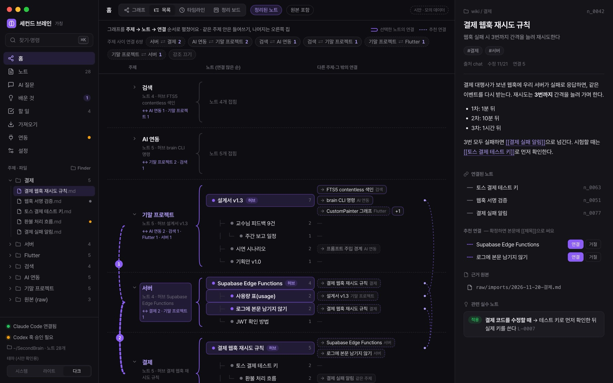

**서버 ⇄ 결제** 쌍을 누른 상태.

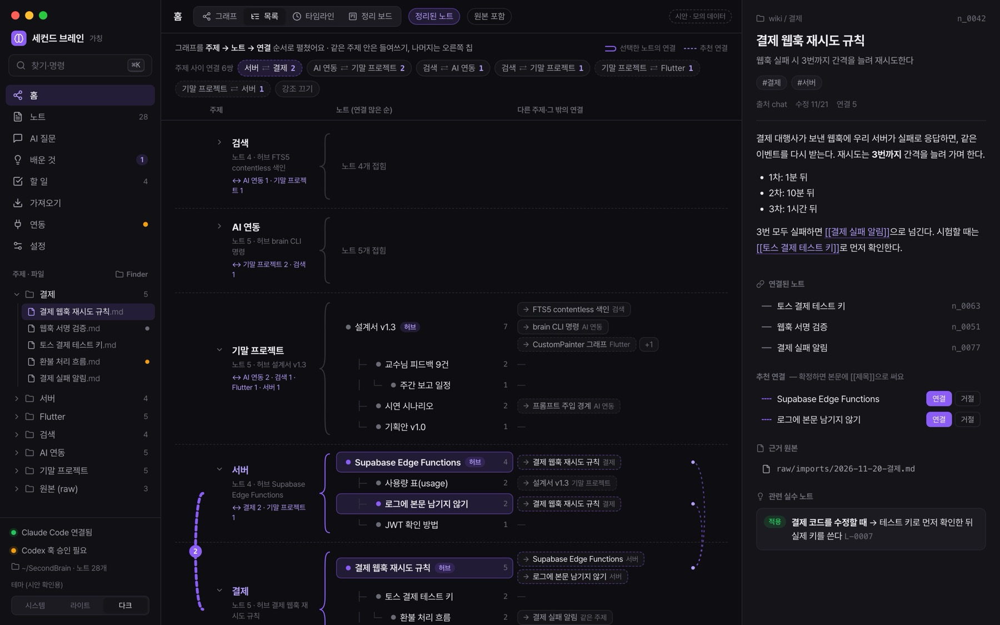

허브 주제인 **기말 프로젝트**를 누른 상태(전체 길이).

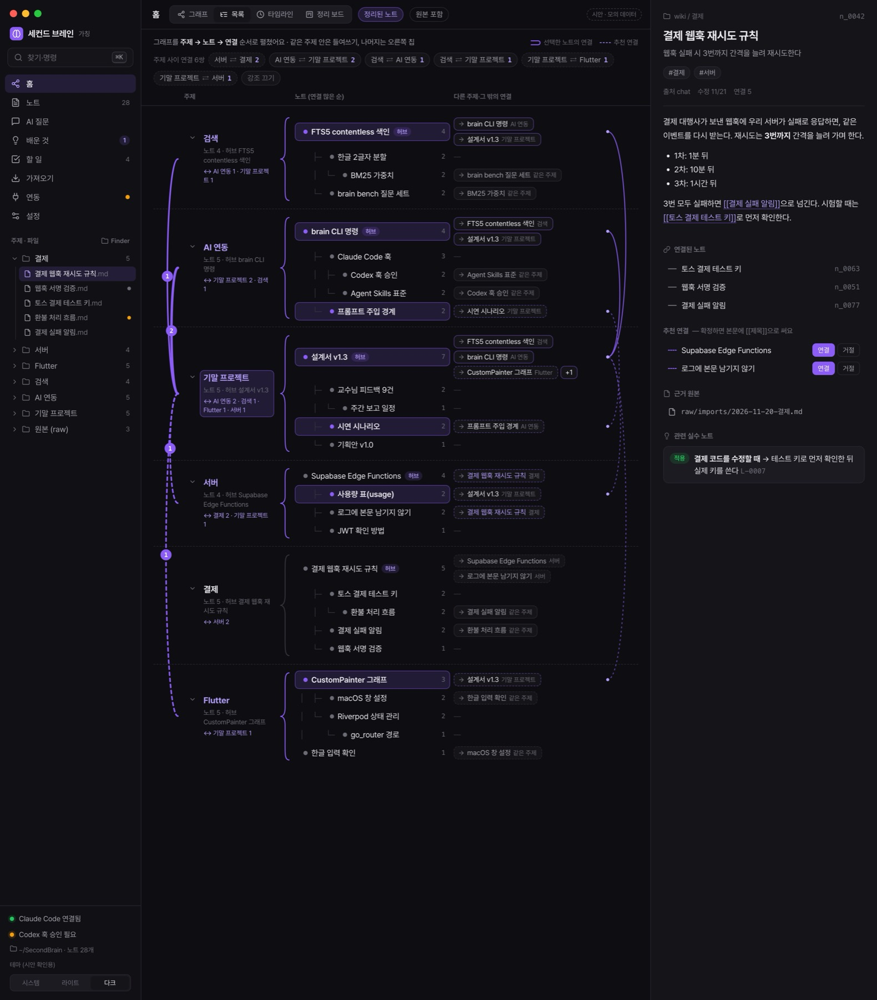

## 상태 변화

**AI 질문 → 틀렸어 → 교정 반영**: [틀렸어]를 누르면 교정 입력 칸이 열리고, [교정 저장]을 누르면 약 1초 동안 "검증 중"을 보여 준 뒤 결과로 바뀐다. 이 사례에서 검증 에이전트는 "노트 값이 옛날 값"이라고 판단해 노트 고침을 제안한다. 일반 규칙(L-0012)은 자동 제안이라 승인 대기로 둔다.

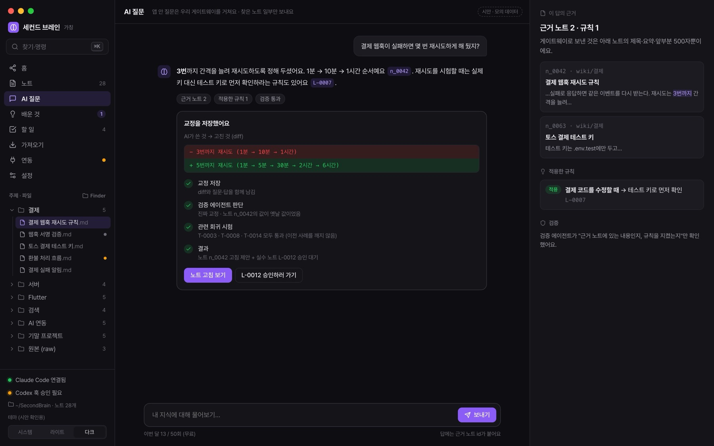

**연동 → 승인 확인**: [승인했어요, 다시 확인]을 누르면 Codex가 연결됨으로 바뀌고 사이드바 표시도 초록이 된다. 아래는 라이트 테마에서 본 승인 뒤 화면이다.

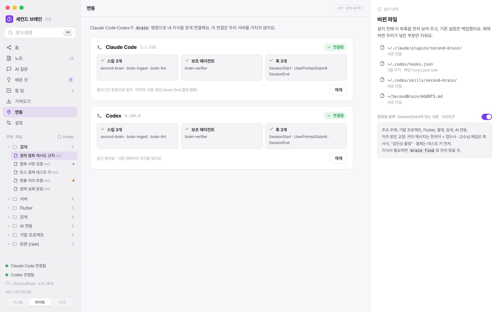

**좁은 창 (1100px)**: 오른쪽 패널이 접히고 툴바 오른쪽에 패널 버튼이 생긴다.

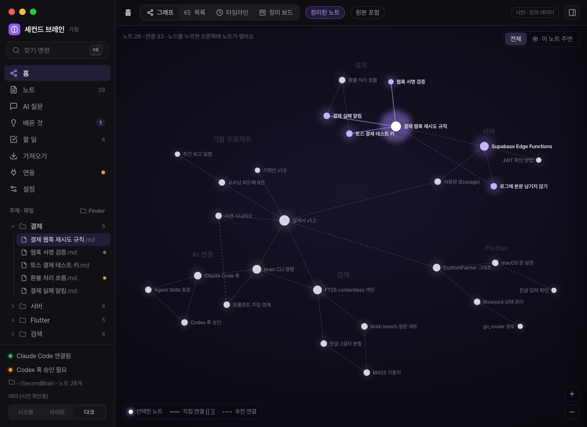

## 검토 방법

- URL: http://localhost:4173 (이 폴더에서 `python3 -m http.server 4173 --directory src`)
- 주소 뒤에 상태를 붙이면 바로 열린다: `#screen=home|chat|lessons|connect`, `&theme=dark|light|system`, `&view=list|timeline|board`, `&scope=local&depth=1|2`, `&raw=r1`, `&open=pay,ai,raw`(펼칠 폴더), `&closed=project,search`(구조 목록에서 접을 주제), `#screen=notes`(노트 표), `&pair=server%7Cpay`(주제 쌍 강조), `&focus=server`(누른 주제), `&cmdk=1&q=웹훅`, `&chat=corrected`, `&connect=done`
- 검증한 상호작용 (앱 안 브라우저, 2026-11-06):
  - 그래프 노드 클릭 → 오른쪽 패널이 그 노트로 바뀜 (`CustomPainter 그래프` 확인)
  - ⌘K → "훅" 입력 → 결과 4개 → ↵ → 첫 노트가 열리고 명령 창이 닫힘
  - AI 질문 → 틀렸어 → 교정 저장 → 1.5초 뒤 4단계 결과와 버튼 2개
  - 연동 → 승인했어요 → 경고 0개, 사이드바 "Codex 연결됨"
  - 배운 것 → L-0012 카드 → 오른쪽에 회귀 시험 T-0014
  - (v2) 이 노트 주변 → 노드 6개(1단계) → 2단계 9개 → `토스 결제 테스트 키` 클릭 → 가운데와 오른쪽 패널이 바뀜
  - (v2) 타임라인 → 날짜 3묶음 → 노트 칩 `CustomPainter 그래프` → 오른쪽 패널이 바뀜 (보기는 타임라인 유지)
  - (v2) 정리 보드 → 열 4개 → 원본 카드 → 오른쪽 원본 상세 → 노트 카드 → 오른쪽 노트
  - (v3) 처음 열면 선택한 노트의 폴더(결제)만 펼쳐짐 → AI 연동 폴더 펼치기 → `Codex 훅 승인.md` 클릭 → 오른쪽 노트·그래프 선택·파일 강조가 함께 바뀜
  - (v3) 배운 것 화면에서 파일 클릭 → 홈으로 돌아와 그 노트가 열림
  - (v3) 원본 (raw) 펼치기 → `sessions/2026-11-20-codex.md` 클릭 → 정리 보드 + 원본 상세
  - (v4) 홈 → 목록 → 제목은 "홈", 사이드바는 홈만 강조, 주제 6묶음 → `FTS5 contentless 색인` 줄 클릭 → 호 4개, 오른쪽 노트 변경 → 검색 주제 접기 → 접힌 줄 표시
  - (v4) 사이드바 노트 → 제목 "노트", 표 28줄 → 행 클릭 → 노트 화면 그대로 오른쪽 노트 변경
  - (v5) 주제 사이(기본) → 왼쪽 호 6개, 숫자 2·2·1·1·1·1 → `서버 ⇄ 결제` 클릭 → 강조 줄 3개, 오른쪽 호 2개, 괄호 2개 보라 → 왼쪽 숫자 원(`AI 연동 ⇄ 기말 프로젝트`) 클릭 → 강조 줄 4개 → 모든 연결 → 흐린 호 6개 + 진한 호 5개 → 선택한 노트 → 호 5개, 쌍 요약 사라짐
  - (v6) 처음 열면 왼쪽 선 0개 → 서버 이름 클릭 → 왼쪽 선 2개(숫자 2·1), 오른쪽 선 3개 → 다시 클릭 → 0개 → `서버 ⇄ 결제` 쌍 클릭 → 왼쪽 선 1개 → 노트 클릭 → 왼쪽 선 0개, 오른쪽에 그 노트 연결 → 화살표로 주제 접기는 그대로 동작
  - (v7) 연결 보기 전환 없음, 안내 문구·범례 복원 확인 → 처음 왼쪽 선 0개·오른쪽 5개 → 서버 클릭 → 왼쪽 2개·오른쪽 3개 → 서버 ⇄ 결제 쌍 → 왼쪽 1개 → 노트 클릭 → 왼쪽 0개·오른쪽 4개
  - (v8, 화면 요소 검사로 확인) 쌍 줄 없음 → 서버 이름에 마우스 → 흐린 선 2개(누를 수 없음) → 마우스 떼기 → 0개 → 서버 클릭 → 진한 선 2개 → 기말 프로젝트에 마우스 → 진한 2개 + 흐린 3개 → 숫자 원(서버 ⇄ 결제) 클릭 → 진한 선 1개, 강조 줄 3개
  - 콘솔 오류 없음
- 스크린샷은 headless Chrome 1440×900(좁은 창은 1100×800), 2배 해상도로 찍었다.

## 가정과 제한

- 노트 28개, 연결 33개, 실수 노트 5개는 모의 데이터다. 날짜(11/20 등)도 예시다.
- 그래프 배치는 시안용 force 배치(모든 쌍 계산)다. 실제 앱은 설계서 5.5대로 Barnes–Hut 근사를 쓴다. 끌기·확대는 아직 동작하지 않는다.
- 아이콘은 Lucide 모양을 따라 그린 시안용 SVG다. 실제 앱은 Lucide 패키지를 쓴다.
- Pretendard는 CDN에서 불러온다. CDN이 막히면 시스템 글꼴로 보인다.
- 할 일·가져오기·설정·로그인·요금제 화면은 이번 시안에 없다 (사이드바에서 누르면 안내만 나온다).
- 정확한 색 값·간격은 이 시안을 기준으로 정하고, 확정되면 설계서 3.2에 덧붙인다.

## 피드백 질문

1. **보라의 양**: 그래프의 선택 노드·이웃, 메뉴, 버튼, 링크에만 보라를 썼다. 더 줄일지, 이 정도가 좋을지?
2. **그래프 밀도**: 노드 이름을 전부 보여 준다. 노드가 많아지면 선택한 노드 주변만 이름을 보여 줄지?
3. **오른쪽 패널 내용**: 노트 본문 아래에 연결·추천 연결·근거 원본·실수 노트까지 넣었다. 너무 많으면 무엇을 뺄지?
4. **교정 카드**: 검증 단계 4개를 다 보여 준다. 사용자에게는 결과만 보여 주고 단계는 접어 둘지?
5. **라이트 테마의 어두운 그래프 카드**: 어색하지 않은지?
6. **(v2) 기본 보기**: 앱을 열었을 때 그래프 대신 타임라인을 먼저 보여 줄지? (매일 쓰는 화면은 타임라인, 둘러보기는 그래프)
7. **(v2) 로컬 그래프 위치**: 지금처럼 그래프 안의 전환 버튼이 좋은지, 오른쪽 노트 패널 위에 작은 로컬 그래프를 항상 둘지?
11. **(v4) 구조 목록 순서**: 주제 순서를 지금처럼 고정(기말 프로젝트 → 검색 → …)으로 둘지, 노트 수나 최근 활동 순으로 바꿀지?
12. **(v4) 호(arc)**: 선택한 노트의 연결만 그린다. 마우스를 올린 노트의 연결도 흐리게 보여 줄지?
9. **(v3) 파일 이름 표시**: `.md` 확장자를 흐리게 보여 준다. 아예 숨길지(일반 사용자용), 지금처럼 둘지(파일이라는 걸 알리기)?
10. **(v3) 파일 정렬**: 지금은 만든 순서다. 이름순·최근 수정순 중 무엇을 기본으로 할지?
8. **(v2) 정리 보드의 "정리 대기"**: AI 초안을 사용자가 확인한 뒤 정리됨으로 옮기는 단계를 둘지, 검증 에이전트가 통과시키면 바로 정리됨으로 갈지?
